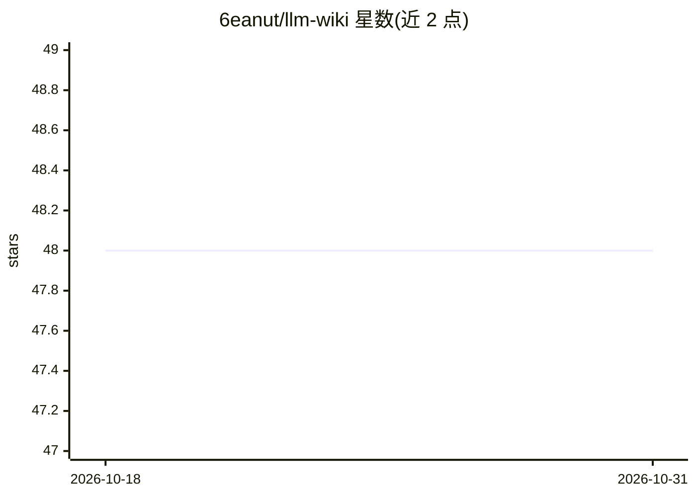

# 6eanut/llm-wiki

⭐ 48 · Shell · MIT · 推送 2026-05-13 · [GitHub](https://github.com/6eanut/llm-wiki) · 个人维护 · 中文 README

**Claude Code 技能：从源文档构建持久互联的知识库**

一个 Claude Code skill，将用户投放的 markdown/文本源文档编译为持久化、双向 wikilink 互联的 wiki 页面（concept/article/person/synthesis 四类）。核心机制：CLAUDE.md 规则驱动 Claude 回答前主动查询 wiki；两阶段 ingest（先分析后生成，含人工检查点）；SHA-256 增量缓存防止重复摄取；LLM 作为运行时，Bash 仅用于确定性操作。支持中英双语页面与跨语言链接。安装通过 git clone 加 quickstart.sh 脚本完成，需在 Claude Code 环境中使用。

## 筛选速览

| 维度 | 判定 | 备注 |
|---|---|---|
| AI 角色 | `ai-ecosystem` | LLM/agent 周边工具 |
| 许可风险 | `permissive` | MIT |
| 部署形态 | `None` |  |
| 模型依赖 | locked-api |  |
| 硬件要求 | — | 无带数字的原话,不猜 |
| 安装摩擦 | `low` | 无编译、无系统依赖或容器化 |
| 成熟度 | — | 结构信号不足 |

## 能力要点

- 两阶段 ingest：分析先行、生成页面前留人工检查点
- SHA-256 增量缓存与 .done 哨兵文件防止重复摄取
- CLAUDE.md + SessionStart hook 驱动 Claude 主动查询 wiki
- 中英双语自动检测（CJK 比例）与跨语言别名链接

## 适用场景

- 把项目文档、笔记沉淀为可持续复用的个人知识库
- 让 Claude 回答问题前先查 wiki，避免每次重新推导
- 维护带出处链（based_on）与置信度标注的资料库

## 场景标签

`知识库管理` · 领域:知识与检索

## 证据(README 行号)

> L7: A **Claude Code skill** that builds and maintains a persistent, interlinked wiki from your source documents. Based o
> L96: |**LLM is the runtime**|All content work done by Claude. No external language runtime needed.|
> L164: ├── SKILL.md                         Skill manifest with proactive usage rules

## 星数曲线

2026-10-18 48 → 2026-10-31 48（+0）

---
*卡片 v1 · prompt 1.4 · 生成 2026-10-25 · 置信度 high · 依据 README sha `750293eed236` · [字段定义](../../DATASET.md)*
