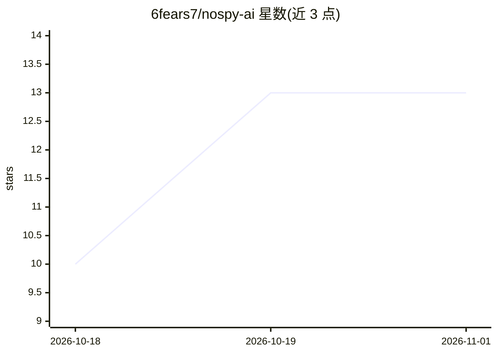

# 6fears7/nospy-ai

⭐ 13 · Go · MIT · 推送 2026-10-18 · [GitHub](https://github.com/6fears7/nospy-ai) · 个人维护

**LLM API 流量中的敏感信息脱敏与还原代理**

nospy 是部署在 AI agent 与 LLM API 之间的前向代理：请求中的密钥与个人数据被替换为占位符，响应中原值再被还原。提供 Wrap 模式（本地启动并包装单个 agent）、Scan 模式（脱敏文件/文本）、Serve 长驻代理（多客户端令牌认证、按路径前缀路由），以及 Kubernetes sidecar 与多副本共享 Service 部署。暴露 Prometheus 指标（按类型/路由统计脱敏量）并附带 Grafana 面板。二进制发行版带 SHA256 校验与构建溯源证明，macOS 二进制未签名，源码构建仅需 Go 1.27 标准库。

## 筛选速览

| 维度 | 判定 | 备注 |
|---|---|---|
| AI 角色 | `ai-ecosystem` | LLM/agent 周边工具 |
| 许可风险 | `permissive` | MIT |
| 部署形态 | `desktop` | 安装包/桌面程序 |
| 模型依赖 | local-ok | 支持本地模型 |
| 硬件要求 | — | 无带数字的原话,不猜 |
| 安装摩擦 | `low` | 无编译、无系统依赖或容器化 |
| 成熟度 | — | 结构信号不足 |

## 能力要点

- 请求脱敏占位符替换、响应自动还原原值
- Wrap/Scan/Serve/Container/Kubernetes 五种运行模式
- Prometheus 指标（nospy_redactions_total 按类型与路由）与 Grafana 面板
- Kubernetes sidecar 与多副本 owner 转发共享 Service 部署

## 适用场景

- 防止 agent 向 LLM API 泄露数据库密码等敏感数据
- 团队内多人共用时按令牌认证并统一脱敏出站请求
- 在 Kubernetes 中以 sidecar 方式为应用容器脱敏 LLM 流量
- 审计脱敏量与类型分布

## 场景标签

 · 领域:LLM 基础设施/隐私安全

## 证据(README 行号)

> L5: `nospy` is a forward proxy that sits between an AI agent and its API. It swaps secrets and personal data in your req
> L23: `nospy serve` runs as a long-lived proxy for several clients, each authenticated by `--auth` and serving routes lis

## 星数曲线

2026-10-18 10 → 2026-11-01 13（+3）

---
*卡片 v1 · prompt 1.4 · 生成 2026-10-31 · 置信度 high · 依据 README sha `9e813ffef282` · [字段定义](../../DATASET.md)*
