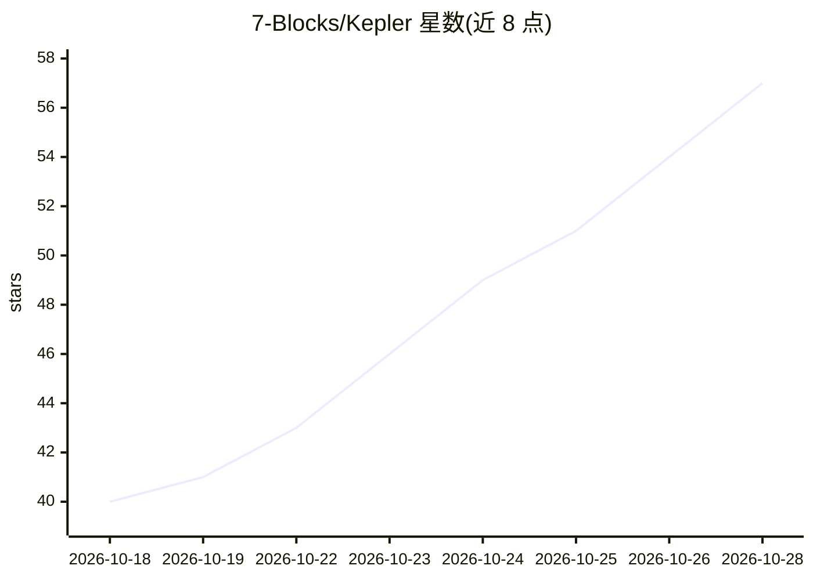

# 7-Blocks/Kepler

⭐ 59 · TypeScript · 推送 2026-10-28 · [GitHub](https://github.com/7-Blocks/Kepler) · [官网](https://kepler.7block.in) · 组织维护

**面向航天运营者的 AI 轨道智能与空间交通管理平台**

Kepler 是监测卫星、追踪空间碎片、预测碰撞风险并生成自主规避建议的轨道智能平台，提供实时轨道可视化（CesiumJS 数字孪生地球）、交会分析、轨道风险评估、空间天气监测与交互式仪表盘。AI 部分使用 OpenAI API 与 LangGraph 的多 Agent 决策系统做碰撞预测与机动建议，数据来自 Space-Track、CelesTrak、NASA DONKI、NOAA SWPC。前端 React/TypeScript，后端 FastAPI + PostgreSQL，由 7-Blocks 团队维护，MIT 许可，本地部署需手动配置环境变量、数据库迁移与前后端分别启动。

## 筛选速览

| 维度 | 判定 | 备注 |
|---|---|---|
| AI 角色 | `ai-native` | 本体是模型或模型工具 |
| 许可风险 | `none` | — |
| 部署形态 | `self-host` | docker 或自建部署 |
| 模型依赖 | — | README 未给出锁定关系 |
| 硬件要求 | — | 无带数字的原话,不猜 |
| 安装摩擦 | `low` | 无编译、无系统依赖或容器化 |
| 成熟度 | — | 结构信号不足 |

## 能力要点

- AI 碰撞预测与多 Agent 决策系统（OpenAI API + LangGraph）
- 实时卫星与碎片追踪、交会分析与轨道风险评估
- CesiumJS 数字孪生地球可视化与空间天气监测
- 整合 Space-Track / CelesTrak / NASA DONKI / NOAA SWPC 数据源

## 适用场景

- 监测在轨卫星与空间碎片的实时状态
- 预测碰撞风险并获取自主规避机动建议
- 在三维地球可视化中查看轨道态势与交会事件

## 场景标签

 · 领域:航天/空间数据分析

## 证据(README 行号)

> L48: Kepler is an AI-powered Orbital Intelligence Platform designed to monitor satellites, track space debris, predict c
> L73: * ⚠️ AI-Based Collision Prediction

## 星数曲线

2026-10-18 40 → 2026-10-28 57（+17）

---
*卡片 v1 · prompt 1.4 · 生成 2026-10-24 · 置信度 mid · 依据 README sha `959a92d6156f` · [字段定义](../../DATASET.md)*
