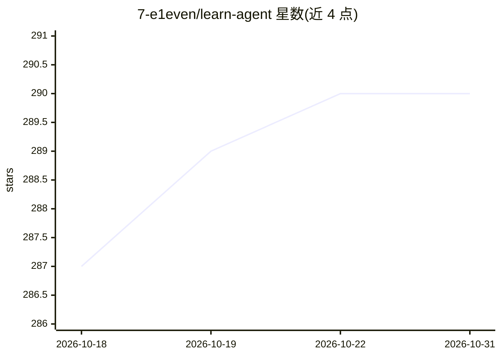

# 7-e1even/learn-agent

⭐ 290 · JavaScript · MIT · 推送 2026-09-05 · [GitHub](https://github.com/7-e1even/learn-agent) · 个人维护 · 中文 README

**AI Agent 开发学习笔记库：拆解 coding agent 内部机制**

作者在开发桌面 agent Reina 过程中记录的机制笔记，主题为 coding agent（Claude Code、Codex、opencode 等）的内部实现。仓库分三块：notes/ 含 s01–s23 每篇一个机制并配可运行 demo；agent_analysis/ 是其他 agent（pi、Kimi CLI）的源码调研档案；interview/ 是整理中的面试题。所有 demo 简化为零依赖、单文件 Node 程序，需 Node 18+，任何 OpenAI 兼容 API key 可运行，多数章节免 key。

## 筛选速览

| 维度 | 判定 | 备注 |
|---|---|---|
| AI 角色 | `ai-knowledge` | 知识聚合/清单类 |
| 许可风险 | `permissive` | MIT |
| 部署形态 | `None` |  |
| 模型依赖 | local-ok | 支持本地模型 |
| 硬件要求 | — | 无带数字的原话,不猜 |
| 安装摩擦 | `low` | 无编译、无系统依赖或容器化 |
| 成熟度 | — | 结构信号不足 |

## 能力要点

- s01–s23 每篇讲一个 agent 机制，配可运行单文件 demo
- 笔记源自桌面 agent Reina 的生产实现简化
- 零依赖、Node 18+，支持任意 OpenAI 兼容 API key 或免 key 运行
- 附 agent_analysis/ 源码调研档案与面试题连载

## 适用场景

- 学习 coding agent 的循环与内部实现机制
- 跑通零依赖单文件 demo 验证 agent 机制
- 准备 agent 方向的面试并查阅源码调研档案

## 场景标签

`教程课程` · 领域:学习与行业

## 证据(README 行号)

> L5: 开发桌面 agent Reina 过程中记下的笔记，讲 coding agent（Claude Code、Codex、opencode 这类工具）的内部实现机制。每篇讲一个机制，把 Reina 里的生产实现简化成零依赖、单文件、可直
> L9: 仓库分三块：notes/ 是正篇笔记（s01–s23，每篇一个机制，配可运行 demo）；agent_analysis/ 是其他 agent（pi、Kimi CLI）的源码调研档案，笔记从这里取材；interview/ 是从笔记整理

## 星数曲线

2026-10-18 287 → 2026-10-31 290（+3）

---
*卡片 v1 · prompt 1.4 · 生成 2026-10-22 · 置信度 high · 依据 README sha `18a4482514ae` · [字段定义](../../DATASET.md)*
