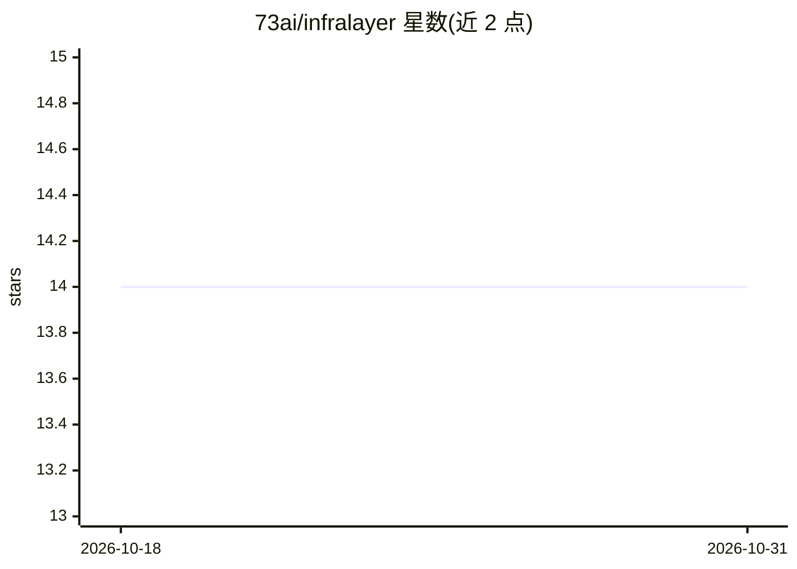

# 73ai/infralayer

⭐ 14 · TypeScript · GPL-3.0 · 推送 2026-04-14 · [GitHub](https://github.com/73ai/infralayer) · [官网](https://docs.infragpt.io) · 组织维护

**云端基础设施管理的 AI SRE 副驾驶（Slack/CLI 接入）**

原名 InfraGPT，后更名为 InfraLayer。面向云基础设施运维团队：用户通过 Slack 频道或 CLI 发起自然语言请求，后端服务经 Socket Mode 接收，通过 gRPC 调用 Agent Service 做 LLM 处理，将自然语言转换为基础设施命令、生成 Terraform 等 IaC 代码，并支持 GitHub PR 管理、RCA 分析与多 Agent 路由。CLI 以 pipx 安装，支持 OpenAI GPT-4o 与 Anthropic Claude 模型；另含 PostgreSQL 持久化的后端服务和 React Web 控制台，采用 GPL-3.0 许可。

## 筛选速览

| 维度 | 判定 | 备注 |
|---|---|---|
| AI 角色 | `ai-native` | 本体是模型或模型工具 |
| 许可风险 | `viral` | GPL-3.0 |
| 部署形态 | `library` | 以包/库形式分发 |
| 模型依赖 | locked-api |  |
| 硬件要求 | — | 无带数字的原话,不猜 |
| 安装摩擦 | `low` | 无编译、无系统依赖或容器化 |
| 成熟度 | — | 结构信号不足 |

## 能力要点

- 自然语言转基础设施命令，生成 Terraform 等 IaC 代码
- Slack Socket Mode 集成与 CLI 两种交互入口
- 多 Agent 框架，支持 GPT-4o 与 Anthropic Claude 模型
- 支持 Slack、GitHub、Terraform 集成与 Web 控制台

## 适用场景

- 通过 Slack 对话执行基础设施管理操作
- 用自然语言生成 Terraform 等基础设施代码
- 在 CLI 中以自然语言查询并执行基础设施命令

## 场景标签

`代码生成` · 领域:编码与开发

## 证据(README 行号)

> L9: InfraLayer is an AI SRE Copilot for the Cloud that provides infrastructure management agents through Slack integrati
> L22: - **🗣️ Natural Language Processing**: Convert natural language to infrastructure commands
> L42: - Support for OpenAI GPT-4o and Anthropic Claude models

## 星数曲线

2026-10-18 14 → 2026-10-31 14（+0）

---
*卡片 v1 · prompt 1.4 · 生成 2026-10-31 · 置信度 high · 依据 README sha `6a467173a54c` · [字段定义](../../DATASET.md)*
