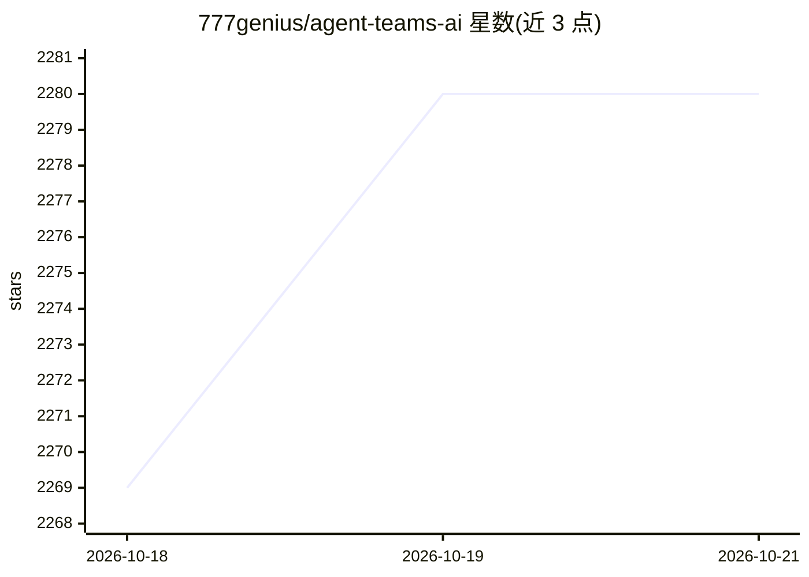

# 777genius/agent-teams-ai

⭐ — · [GitHub]() · 组织维护

**编排多 AI 编码代理团队的免费桌面应用**

Electron 桌面应用，作为跨 Codex/Claude/OpenCode/Cursor/Grok/GitHub Copilot/Kiro/Z.AI/MiniMax/Kimi 等多种编码代理运行时（300+ 模型、200+ LLM 提供商）的编排层：用一个提示创建具有不同角色、可并行自主工作的代理团队，通过看板观察任务流转，代理之间可通信、互相创建任务与代码评审。支持免注册免费模型启动、自动检测已装运行时、逐步审批工具操作、token 用量与预算分析、组织层级、集成终端与代码编辑器、MCP 集成、29 种界面语言。提供 macOS/Windows/Linux 安装包，无需前置依赖。面向开发者的编码与项目工作。

## 筛选速览

| 维度 | 判定 | 备注 |
|---|---|---|
| AI 角色 | `ai-ecosystem` | LLM/agent 周边工具 |
| 许可风险 | `viral` | — |
| 部署形态 | `desktop` | 安装包/桌面程序 |
| 模型依赖 | — | README 未给出锁定关系 |
| 硬件要求 | — | 无带数字的原话,不猜 |
| 安装摩擦 | `low` | 无编译、无系统依赖或容器化 |
| 成熟度 | — | 结构信号不足 |

## 能力要点

- 一句话创建多角色代理团队，看板跟踪自主并行任务
- 接入 Claude Code、Codex、OpenCode、Cursor、GitHub Copilot 等多种运行时，免 auth 免费模型可启动
- 代理间通信、跨团队协作与内置互相评审工作流
- token 用量/成本分析与预算告警（80%/100%），组织层级总览

## 适用场景

- 让多个 AI 编码代理并行自主完成项目任务，我只在看板上把控
- 统一管理已有的 Claude Code、Codex、Cursor 等订阅来跑代理团队
- 对代理产出的代码做文件级/代码块级评审与审批

## 场景标签

`多智能体` `编码 Agent` `代码审查` · 领域:Agent 开发

## 证据(README 行号)

> L12:  Free desktop app for AI agent teams. Start with a free model with no auth - no signup, API key, or card - or conne
> L108: An orchestration layer for AI agent teams across Codex/Claude/OpenCode/Cursor/Grok/GitHub/Kiro/Z.AI/Xiaomi/MiniMax
> L121: - **Multi-provider orchestration** — start with a free model with no auth, auto-detect available Claude Code, Code

## 星数曲线

2026-10-18 2,269 → 2026-10-21 2,280（+11）

---
*卡片 v1 · prompt 1.4 · 生成 2026-10-21 · 置信度 mid · 依据 README sha `ff0b88a2c302` · [字段定义](../../DATASET.md)*
