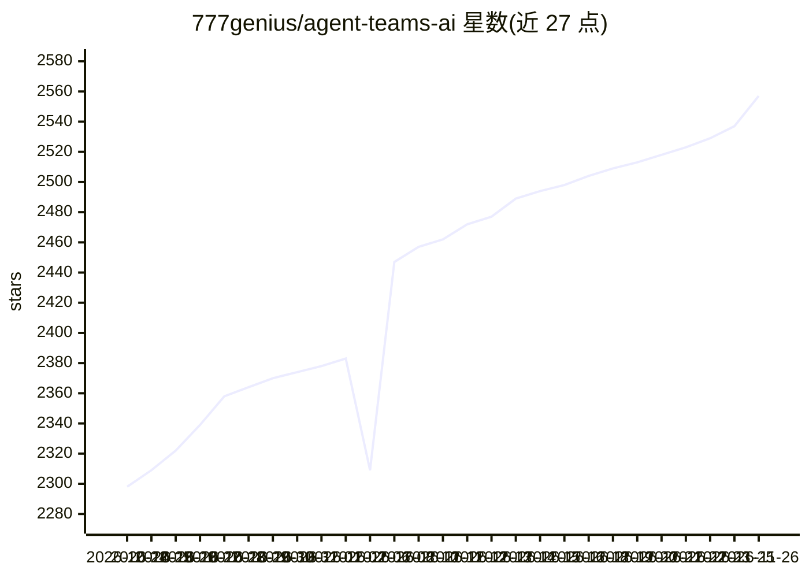

# 777genius/agent-teams-ai

⭐ 2,557 · TypeScript · AGPL-3.0 · 推送 2026-11-25 · [GitHub](https://github.com/777genius/agent-teams-ai) · [官网](https://agentteams.live) · 组织维护 · 中文 README

**多 AI 编码 agent 团队编排的桌面看板工作台**

免费开源的跨平台桌面应用（macOS/Windows/Linux，Electron），让用户以层级化团队组织 AI 编码 agent：为每个成员设定角色、模型与运行时，agent 自主创建任务、相互通信与评审，工作经看板、任务表和实时 agent 图展示。支持 300+ 模型、200+ 提供商，可接入已安装的 Claude Code/Codex/OpenCode 运行时，配 token 用量与预算分析、本地优先存储和定时调度。

## 筛选速览

| 维度 | 判定 | 备注 |
|---|---|---|
| AI 角色 | `ai-ecosystem` | LLM/agent 周边工具 |
| 许可风险 | `viral` | AGPL-3.0 |
| 部署形态 | `desktop` | 安装包/桌面程序 |
| 模型依赖 | local-ok | 支持本地模型 |
| 硬件要求 | — | 无带数字的原话,不猜 |
| 安装摩擦 | `low` | 无编译、无系统依赖或容器化 |
| 成熟度 | — | 结构信号不足 |

## 能力要点

- 层级化 agent 团队：lead 分解任务、指派成员、互相评审
- 自动检测已安装的 Claude Code/Codex/OpenCode 运行时，支持 300+ 模型/200+ 提供商
- Token 用量分析与月度预算（全局/团队/项目级，含告警阈值）
- 本地优先：团队与任务数据由桌面应用本地管理

## 适用场景

- 把一个功能开发拆给多个 AI agent 协作完成并通过看板跟进
- 在同一界面混用订阅账号、API key 和本地模型驱动不同 agent
- 按团队/项目设置 token 预算并追踪用量趋势
- 用定时计划（cron）自动运行 agent 团队任务

## 场景标签

`多智能体` `编码 Agent` · 领域:Agent 开发

## 证据(README 行号)

> L14:  Give each teammate a role, each team a lead, and organize teams into a hierarchy. Agents create tasks, delegate, t
> L15:  Free, open-source desktop app for macOS, Windows and Linux. For coding and broader project work. 300+ models · 200
> L120: Agent Teams AI is a free, open-source workspace for building and running AI teams across Codex, Claude Code, OpenC

## 星数曲线

2026-10-24 2,298 → 2026-11-26 2,557（+259）

---
*卡片 v1 · prompt 1.4 · 生成 2026-11-26 · 置信度 mid · 依据 README sha `8a43e69e1bea` · [字段定义](../../DATASET.md)*
