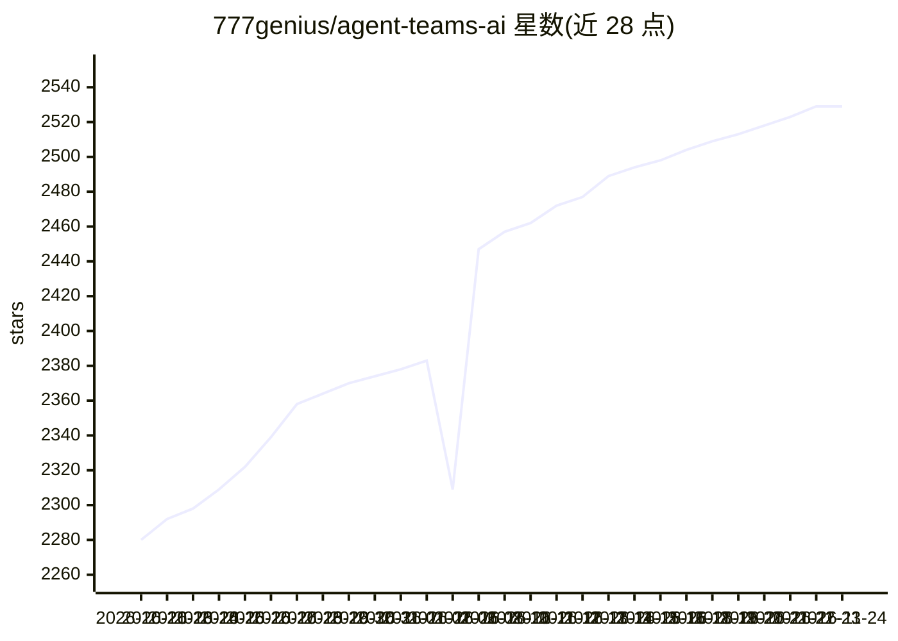

# 777genius/agent-teams-ai

⭐ 2,529 · TypeScript · AGPL-3.0 · 推送 2026-11-22 · [GitHub](https://github.com/777genius/agent-teams-ai) · [官网](https://agentteams.live) · 个人维护 · 中文 README

**AI agent 团队编排桌面应用：看板指挥多 agent 协作干活**

跨平台桌面应用（Electron），将多个 AI agent 组成带角色分工的团队：用户在 kanban 看板下达高层指令，agent 并行执行任务、相互通信、互审工作，支持组织层级、Solo 模式、逐操作审批、任务级日志与 token 用量/预算分析。编排层接入 Claude Code、Codex、OpenCode 运行时（可自动检测）及 Cursor、GitHub Copilot、Z.AI、MiniMax、Kiro 等服务；默认提供免注册免 API key 的免费模型起步。提供 macOS/Windows/Linux 安装包。

## 筛选速览

| 维度 | 判定 | 备注 |
|---|---|---|
| AI 角色 | `ai-ecosystem` | LLM/agent 周边工具 |
| 许可风险 | `viral` | AGPL-3.0 |
| 部署形态 | `desktop` | 安装包/桌面程序 |
| 模型依赖 | locked-api |  |
| 硬件要求 | — | 无带数字的原话,不猜 |
| 安装摩擦 | `low` | 无编译、无系统依赖或容器化 |
| 成熟度 | — | 结构信号不足 |

## 能力要点

- 多 agent 团队看板编排：自动执行、相互通信与互审
- 自动检测 Claude Code/Codex/OpenCode 运行时，或连接 Cursor/Copilot/Z.AI/MiniMax/Kiro
- token 用量、成本与预算分析，80%/100% 阈值告警
- 内置终端、代码编辑器、Git worktree 分支策略与 MCP 集成

## 适用场景

- 用一个提示组建角色化 agent 团队并行处理编码与项目任务
- 在本地以 GUI 审批、评论和追踪各 agent 的任务进度
- 为多模型多订阅的使用方式做 token 成本核算与预算控制

## 场景标签

`多智能体` `编码 Agent` · 领域:Agent 开发

## 证据(README 行号)

> L13:  Free cross-platform desktop app for AI agent teams. Start with a free model with no auth - no signup, API key, or 
> L114: An orchestration layer for AI agent teams across Codex/Claude/OpenCode/Cursor/Grok/GitHub/Kiro/Z.AI/Xiaomi/MiniMax
> L127: - **Multi-provider orchestration** — start with a free model with no auth, auto-detect available Claude Code, Code

## 星数曲线

2026-10-21 2,280 → 2026-11-24 2,529（+249）

---
*卡片 v1 · prompt 1.4 · 生成 2026-11-23 · 置信度 mid · 依据 README sha `8178dd109c00` · [字段定义](../../DATASET.md)*
