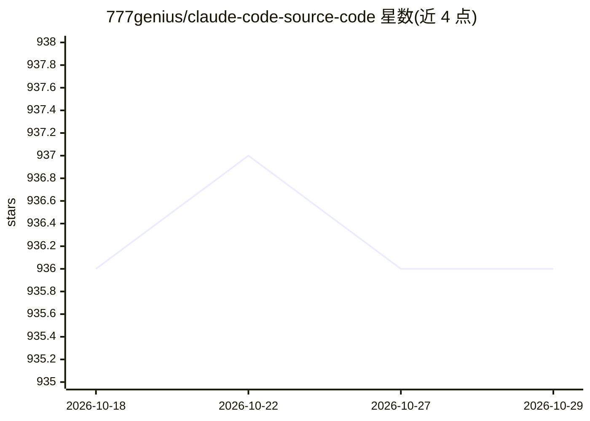

# 777genius/claude-code-source-code

⭐ 936 · 推送 2026-10-08 · [GitHub](https://github.com/777genius/claude-code-source-code) · 个人维护

**Claude Code 源码镜像的指针仓库：代码已迁移**

777genius 名下的指针仓库，说明本项目实际源码已迁移至 claude-code-source-code-full 等主仓库，本仓库仅保留用于检索可见性。README 列出四个关联项目：claude-code-working（主工作仓库）、claude-code-source-code-full（完整源码）、claude-multimodel（多模型 Claude 工作流），以及 agent-teams-ai、agent-notifications 两个推广项目。不含安装说明、构建指引或功能文档。

## 筛选速览

| 维度 | 判定 | 备注 |
|---|---|---|
| AI 角色 | `ai-native` | 本体是模型或模型工具 |
| 许可风险 | `none` | — |
| 部署形态 | `None` |  |
| 模型依赖 | — | README 未给出锁定关系 |
| 硬件要求 | — | 无带数字的原话,不猜 |
| 安装摩擦 | `low` | 无编译、无系统依赖或容器化 |
| 成熟度 | — | 结构信号不足 |

## 能力要点

- 声明自身为指针仓库，完整源码已迁移
- 列出 4 个关联项目及各自角色
- 无安装或运行说明

## 适用场景

- 查找 Claude Code 相关源码的实际所在仓库
- 了解 777genius 系列项目的组织结构

## 场景标签

 · 领域:AI 编程工具/源码

## 证据(README 行号)

> L10: > This repository is now kept as a pointer repository for discoverability.
> L21: The full source code for this project has moved to 777genius/claude-code-source-code-full.

## 星数曲线

2026-10-18 936 → 2026-10-29 936（+0）

---
*卡片 v1 · prompt 1.4 · 生成 2026-10-21 · 置信度 low · 依据 README sha `7bd5d920ff3e` · [字段定义](../../DATASET.md)*
