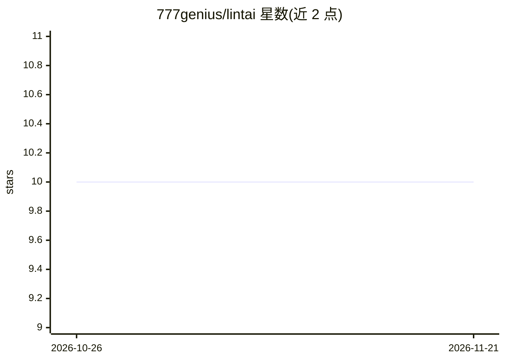

# 777genius/lintai

⭐ 10 · Rust · 推送 2026-10-28 · [GitHub](https://github.com/777genius/lintai) · [官网](https://777genius.github.io/lintai/) · 个人维护

**AI 基础设施工件的安全检查器：合并前审查 agent 配置**

面向 AI agent 生态的本地安全 linter，扫描决定 agent 行为的文件：SKILL.md、CLAUDE.md 等 agent 指令、mcp.json 等 MCP/客户端配置、插件与 hook 清单，以及可选的 npm lockfile 依赖咨询通道。默认离线运行、单二进制、确定性输出带证据，支持文本/JSON/SARIF 报告与退出码门禁，通过 lintai.toml 预设策略分级（recommended/preview/threat-review 等）。不声称保证工件完全安全。提供安装脚本与可选 npm 包装器，适用于本地工作流与 CI。

## 筛选速览

| 维度 | 判定 | 备注 |
|---|---|---|
| AI 角色 | `ai-ecosystem` | LLM/agent 周边工具 |
| 许可风险 | `none` | — |
| 部署形态 | `library` | 以包/库形式分发 |
| 模型依赖 | — | README 未给出锁定关系 |
| 硬件要求 | — | 无带数字的原话,不猜 |
| 安装摩擦 | `low` | 无编译、无系统依赖或容器化 |
| 成熟度 | `idea` | |

## 能力要点

- 默认离线、单原生二进制、无需 Python 运行时或模型 API key
- 确定性静态检查，findings 带稳定规则 ID 与结构化证据
- 支持 JSON/SARIF 输出与退出码，适合 CI 门禁
- lintai.toml 预设策略分级与 override 合并规则

## 适用场景

- 合并前审查仓库中的 MCP 配置、hooks、skills 等可信面
- 作者在发布/分享 skill 或插件前自检
- 团队在 CI 中对 agent 工件强制门禁检查
- 审计本机 AI 客户端已安装配置（scan-known/inventory-os）

## 场景标签

`网络安全` · 领域:学习与行业

## 证据(README 行号)

> L7: `lintai` checks the files that quietly decide what coding agents can run, access, and inherit before merge. It helps
> L24: Think of it as a Ruff/Biome-style workflow for agent artifact review: fast, deterministic, and meant to run often.

## 星数曲线

2026-10-26 10 → 2026-11-21 10（+0）

---
*卡片 v1 · prompt 1.4 · 生成 2026-11-20 · 置信度 mid · 依据 README sha `3861932d0dbd` · [字段定义](../../DATASET.md)*
