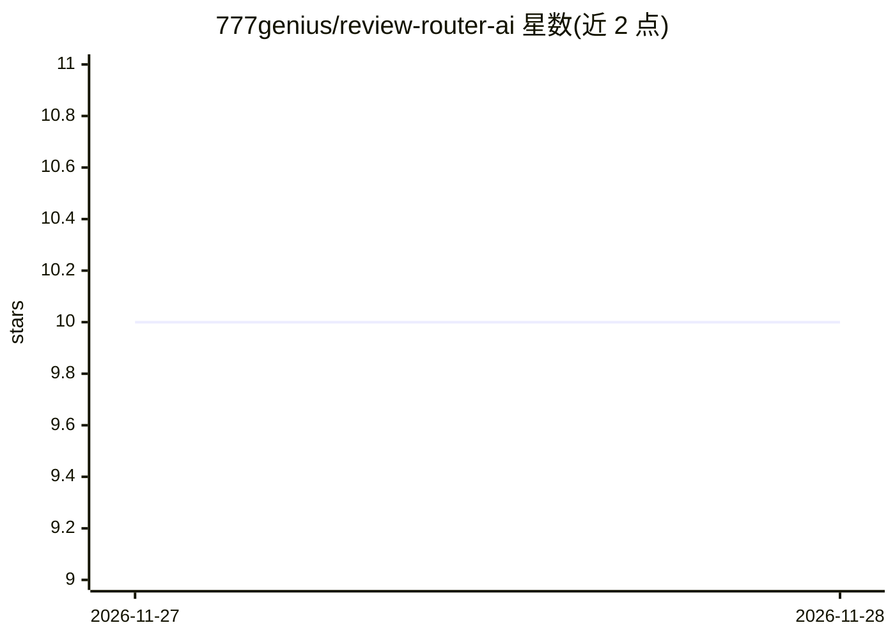

# 777genius/review-router-ai

⭐ 10 · TypeScript · Apache-2.0 · 推送 2026-11-27 · [GitHub](https://github.com/777genius/review-router-ai) · [官网](https://reviewrouter.org) · 组织维护

**在自家 CI/CD 里用自有 AI 账号运行 GitHub PR 代码评审**

基于 OpenCodeReview 构建的 AI 代码评审系统：在 GitHub Actions 中接入用户自己的 AI 提供商订阅账号或 API，对 PR 生成按严重度分级、逐行定位的评审意见与摘要，并提供集中管理模型、账号与评审规则的仪表盘。支持多评审人并行并要求一致才发布、PR 评论命令交互（/rr review、/rr fixed 等）、Memory/Skills/MCP 扩展机制，以及评审历史与用量统计。可通过托管服务使用，或在 Linux x64 服务器上用 Docker Compose 脚本自托管；GitLab 集成尚在开发中。

## 筛选速览

| 维度 | 判定 | 备注 |
|---|---|---|
| AI 角色 | `ai-native` | 本体是模型或模型工具 |
| 许可风险 | `permissive` | Apache-2.0 |
| 部署形态 | `self-host` | docker 或自建部署 |
| 模型依赖 | locked-api |  |
| 硬件要求 | — | 无带数字的原话,不猜 |
| 安装摩擦 | `low` | 无编译、无系统依赖或容器化 |
| 成熟度 | — | 结构信号不足 |

## 能力要点

- 接入 Codex、Claude Code、OpenRouter、Kimi 等提供商的订阅/OAuth/API key 账号
- 多评审人并行评审并要求一致后才发布行内发现
- PR 评论命令交互：/rr review、/rr fixed、/rr suggest fix 等
- Memory（Hindsight）、版本化 Skills 与远程 MCP 工具接入

## 适用场景

- 在 GitHub PR 上自动运行 AI 代码评审而不额外购买评审服务
- 用自己已有的 Claude/Codex 订阅账号池控制评审成本
- 集中管理多个仓库的评审模型、规则与用量统计
- 在内网基础设施上自托管部署评审服务

## 场景标签

`代码审查` · 领域:编码与开发

## 证据(README 行号)

> L3: AI code review for GitHub pull requests, powered by OpenCodeReview.
> L53: - **AI providers and accounts.** Connect Codex, Claude Code, OpenRouter,
> L164: ReviewRouter uses OpenCodeReview.

## 星数曲线

2026-11-27 10 → 2026-11-28 10（+0）

---
*卡片 v1 · prompt 1.4 · 生成 2026-11-27 · 置信度 high · 依据 README sha `256433ea29fe` · [字段定义](../../DATASET.md)*
