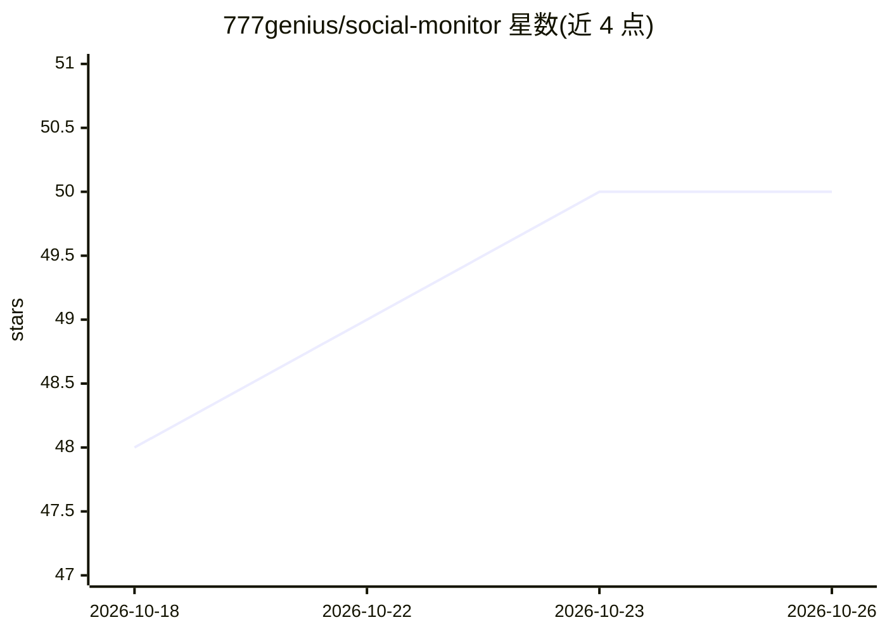

# 777genius/social-monitor

⭐ 50 · TypeScript · Apache-2.0 · 推送 2026-10-24 · [GitHub](https://github.com/777genius/social-monitor) · [官网](https://social-monitor.app) · 个人维护

**自托管社媒/新闻聚合监控工具：跨源收集、排序并生成 AI 摘要**

全栈自托管的内容监控产品：从 X/Twitter、Reddit、Hacker News、RSS/Atom、GitHub 等来源收集帖子，对内容做排序，生成带来源链接的 AI 摘要，支持每日摘要、四小时滚动更新与每周汇总管线；兴趣画像、帖子评分与相关性反馈参与个性化排序。技术栈为 Flutter/Dart、NestJS/TypeScript、PostgreSQL、RabbitMQ 和 Redis，通过 Docker Compose 一键启动；RSS 与 Hacker News 无需账号或 API key，X 依赖私有收集器，多数 provider 为 beta 实现，项目处于积极开发中。

## 筛选速览

| 维度 | 判定 | 备注 |
|---|---|---|
| AI 角色 | `ai-enhanced` | 去掉 AI 部分产品仍成立 |
| 许可风险 | `permissive` | Apache-2.0 |
| 部署形态 | `None` |  |
| 模型依赖 | — | README 未给出锁定关系 |
| 硬件要求 | — | 无带数字的原话,不猜 |
| 安装摩擦 | `low` | 无编译、无系统依赖或容器化 |
| 成熟度 | `idea` | |

## 能力要点

- 聚合 X/Reddit/Hacker News/RSS/GitHub 等来源并做排序
- 生成带来源引用的 AI 摘要与每日/每周汇总
- 兴趣画像与相关性反馈驱动个性化排序
- Docker Compose 一键启动，RSS 与 Hacker News 免账号免 key

## 适用场景

- 跟踪关心的议题，跳过各平台的重复与噪音内容
- 定时获得跨来源话题摘要与每周汇总
- 自托管一套可发布分享的舆情/话题监控面板

## 场景标签

`网页抓取` `AI 写作` · 领域:效率与自动化

## 证据(README 行号)

> L7: **Follow your interests, skip the noise.** Social Monitor collects posts across social networks, news and the web, r
> L27: - **Monitor topics across sources:** X/Twitter, Reddit, Hacker News, RSS/Atom and GitHub, with provider-specific se
> L46: Built with **Flutter/Dart, NestJS/TypeScript, PostgreSQL, RabbitMQ and Redis**.

## 星数曲线

2026-10-18 48 → 2026-10-26 50（+2）

---
*卡片 v1 · prompt 1.4 · 生成 2026-10-25 · 置信度 mid · 依据 README sha `f5117231c05b` · [字段定义](../../DATASET.md)*
