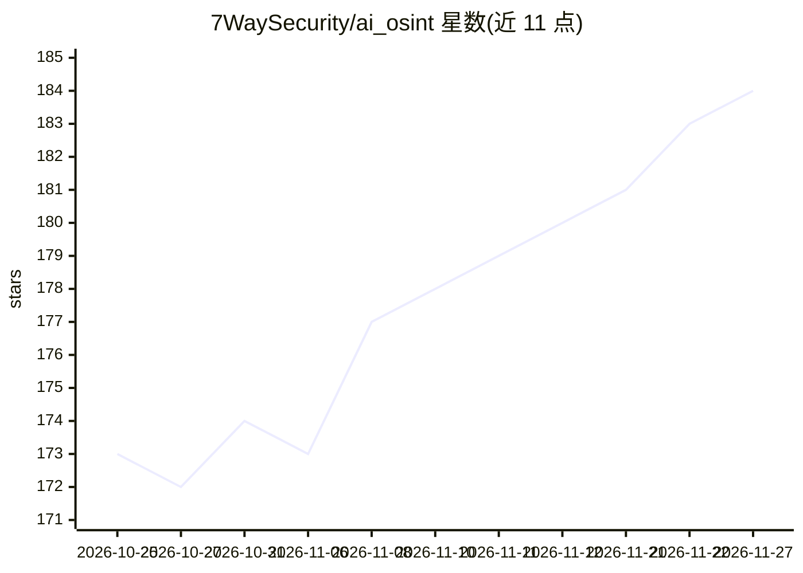

# 7WaySecurity/ai_osint

⭐ 184 · Python · NOASSERTION · 推送 2026-10-29 · [GitHub](https://github.com/7WaySecurity/ai_osint) · [官网](https://www.7waysecurity.co) · 组织维护

**面向红队与 OSINT 研究者的 AI 基础设施暴露面侦察资源清单**

收录用于发现互联网上暴露 AI 基础设施的 Google dork、Shodan/Censys 查询、GitHub dork、Sigma 检测规则与安全工具，覆盖 LLM 端点、聊天会话泄露、向量数据库、agent 网关、MLOps 平台与各厂商 API key 泄露模式。v2.0 新增 shadow-ai 部分，从被动公开来源测量单一组织未经批准的 AI 暴露面，含评分模型与不主动接触目标主机的采集脚本。所有查询使用 KEYWORD 占位符，要求替换为授权搜索的范围词。

## 筛选速览

| 维度 | 判定 | 备注 |
|---|---|---|
| AI 角色 | `ai-knowledge` | 知识聚合/清单类 |
| 许可风险 | `none` | NOASSERTION |
| 部署形态 | `None` |  |
| 模型依赖 | — | README 未给出锁定关系 |
| 硬件要求 | — | 无带数字的原话,不猜 |
| 安装摩擦 | `low` | 无编译、无系统依赖或容器化 |
| 成熟度 | — | 结构信号不足 |

## 能力要点

- Google/GitHub/Shodan/Censys 多引擎 dork 查询集合，按 AI 服务分类组织
- KEYWORD 占位符约定，查询须限定在授权范围资产
- shadow-ai 部分：五个被动采集面与经批准用途扣减的评分模型
- 各 AI 服务默认端口、认证默认状态与 API key 前缀/正则参考表

## 适用场景

- 红队与渗透测试中枚举授权范围内的暴露 AI 服务
- Bug bounty 中定位自身或授权目标的 AI 凭证泄露
- 企业安全团队用 Sigma 规则监控内部 AI 基础设施
- 从公开来源测量本组织未经批准的 AI 使用暴露面

## 场景标签

`精选清单` `网络安全` · 领域:学习与行业

## 证据(README 行号)

> L5:  Curated OSINT resources for discovering exposed AI infrastructure — dorks, queries, tools, and techniques for LLM, 
> L15: > **AI OSINT** is a curated collection of Google dorks, Shodan queries, GitHub dorks, Censys queries, Sigma detecti
> L25: - A passive collector (`shadow-ai/scripts/shadow_ai_footprint.py`). Nothing in the section contacts a discovered ho

## 星数曲线

2026-10-25 173 → 2026-11-27 184（+11）

---
*卡片 v1 · prompt 1.4 · 生成 2026-11-27 · 置信度 high · 依据 README sha `2d71bdee47f2` · [字段定义](../../DATASET.md)*
