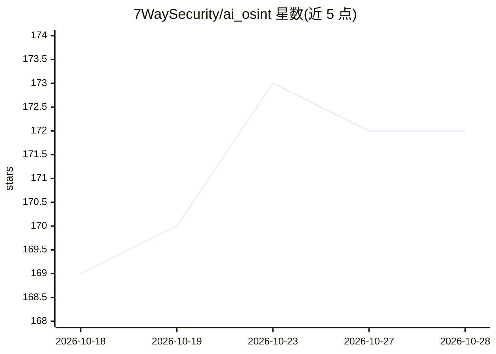

# 7WaySecurity/ai_osint

⭐ 172 · NOASSERTION · 推送 2026-06-19 · [GitHub](https://github.com/7WaySecurity/ai_osint) · [官网](https://www.7waysecurity.co) · 组织维护

**AI 基础设施暴露面 OSINT 查询集：面向红队与攻防人员**

策展型 OSINT 资源集合：提供 Google dorks、Shodan/Censys 查询、GitHub dorks、API key 前缀与正则、向量数据库枚举端点、Sigma 检测规则等，用于发现暴露的 LLM 端点（Ollama/vLLM/LM Studio）、AI 对话泄露、向量数据库（Qdrant/Weaviate/ChromaDB/Milvus）、MCP 服务器与泄露的 AI API key。面向红队操作员、渗透测试、漏洞赏金与 OSINT 研究人员。v1.3.0 起用 KEYWORD 占位符替代硬编码凭据字符串，要求使用者限定自身授权范围；代码 MIT、内容 CC BY-SA 4.0。

## 筛选速览

| 维度 | 判定 | 备注 |
|---|---|---|
| AI 角色 | `ai-knowledge` | 知识聚合/清单类 |
| 许可风险 | `none` | NOASSERTION |
| 部署形态 | `None` |  |
| 模型依赖 | — | README 未给出锁定关系 |
| 硬件要求 | — | 无带数字的原话,不猜 |
| 安装摩擦 | `low` | 无编译、无系统依赖或容器化 |
| 成熟度 | — | 结构信号不足 |

## 能力要点

- 覆盖 Google/Shodan/Censys/GitHub 四类查询的策展集合
- 20+ AI 提供商的 API key 前缀参考与检测正则
- 向量数据库枚举端点表（Qdrant/Weaviate/ChromaDB/Milvus）
- v1.3.0 起 KEYWORD 占位符约定，限定授权测试范围

## 适用场景

- 红队/渗透测试中排查企业自有 AI 资产的暴露面
- 漏洞赏金项目中定位暴露的 LLM 端点与向量数据库
- 安全团队编写针对 AI 基础设施的监控规则

## 场景标签

`网络安全` `精选清单` · 领域:学习与行业

## 证据(README 行号)

> L15: > **AI OSINT** is a curated collection of Google dorks, Shodan queries, GitHub dorks, Censys queries, Sigma detecti
> L5:  Curated OSINT resources for discovering exposed AI infrastructure — dorks, queries, tools, and techniques for LLM, 

## 星数曲线

2026-10-18 169 → 2026-10-28 172（+3）

---
*卡片 v1 · prompt 1.4 · 生成 2026-10-22 · 置信度 high · 依据 README sha `bc9c5ff6e1f8` · [字段定义](../../DATASET.md)*
