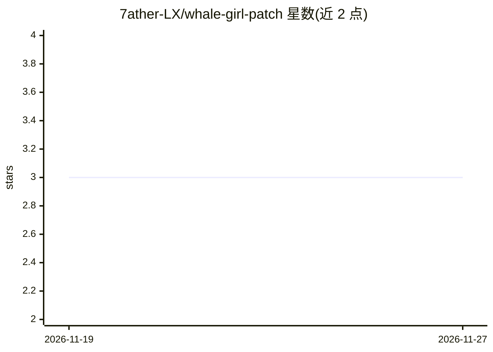

# 7ather-LX/whale-girl-patch

⭐ 3 · JavaScript · NOASSERTION · 推送 2026-11-22 · [GitHub](https://github.com/7ather-LX/whale-girl-patch) · [官网](https://github.com/Banan1cee/whale_girl) · 个人维护 · 中文 README

**给鲸鲸微信机器人加跨聊天记忆与链接阅读的外挂补丁**

面向已安装鲸鲸 / Whale Girl 4.1.7.1 的 Windows 用户的外挂补丁，不可单独运行。通过在 server.js 首行挂钩实现三项增强：跨聊天共享记忆（共享组内交换会话摘要与关键词命中的原话，带 token 预算与只读策略）、主人从私聊指挥机器人向指定群发消息、点开 B 站/小黑盒/网页链接抽取正文与视频画面交给模型。零 npm 依赖，复用鲸鲸自带 Node，提供 install.cmd 安装、本地网页控制台与卸载脚本。

## 筛选速览

| 维度 | 判定 | 备注 |
|---|---|---|
| AI 角色 | `ai-native` | 本体是模型或模型工具 |
| 许可风险 | `none` | NOASSERTION |
| 部署形态 | `desktop` | 安装包/桌面程序 |
| 模型依赖 | local-ok | 支持本地模型 |
| 硬件要求 | — | 无带数字的原话,不猜 |
| 安装摩擦 | `low` | 无编译、无系统依赖或容器化 |
| 成熟度 | — | 结构信号不足 |

## 能力要点

- 跨聊天共享记忆：按共享组读取摘要与原话，只读不复制，带 maxTokens 预算
- 主人私聊指令驱动的跨群发消息，限定 wxid 触发与每小时条数限制
- B 站公开接口取信息并用故事板裁图交看图模型；无头 Edge/Chrome 渲染动态页面
- 零 npm 依赖，仅改 server.js 首行挂钩，支持 install/uninstall 脚本

## 适用场景

- 让机器人在多个群和私聊之间保持记忆互通
- 在私聊里让机器人去指定群发送通知消息
- 让机器人能读取群友发的 B 站视频和网页正文内容

## 场景标签

`聊天机器人` `Agent 记忆` · 领域:Agent 开发

## 证据(README 行号)

> L4: > **这不是独立软件，单独下载本仓库没有任何作用。**
> L7: > 补丁不自带模型、不自带微信自动化、没有独立界面；它只给已经装好的鲸鲸加两个能力。
> L11: **一句话**：让鲸鲸在指定聊天之间记忆互通，主人在私聊里可以让她去另一个群发指定消息，

## 星数曲线

2026-11-19 3 → 2026-11-27 3（+0）

---
*卡片 v1 · prompt 1.4 · 生成 2026-11-22 · 置信度 mid · 依据 README sha `a6f5b163b33e` · [字段定义](../../DATASET.md)*
