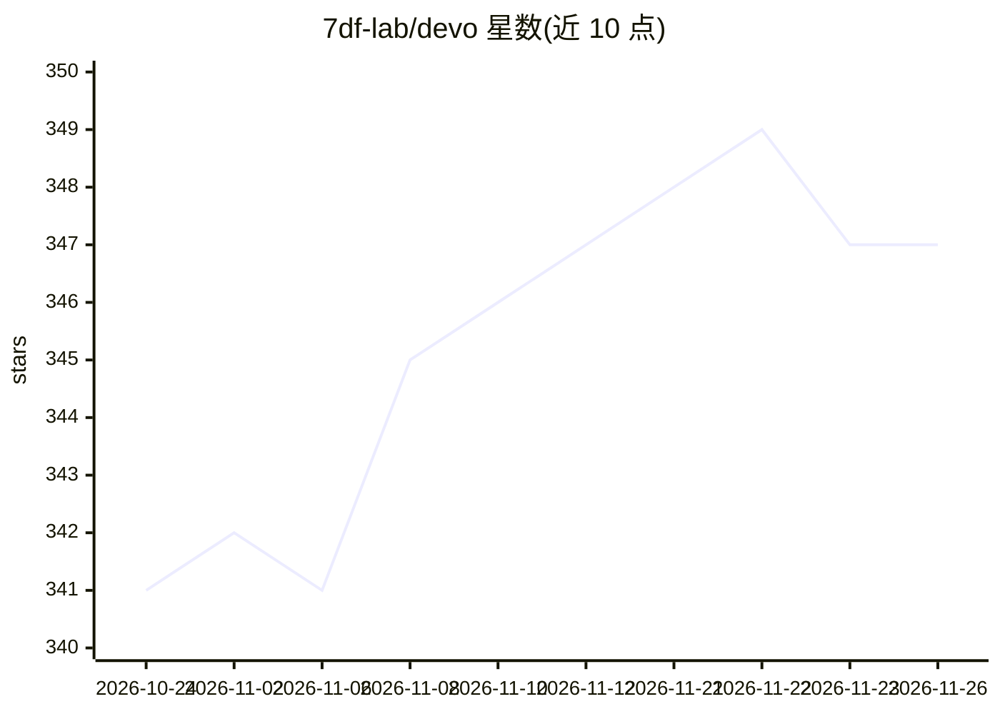

# 7df-lab/devo

⭐ 347 · Rust · MIT · 推送 2026-11-25 · [GitHub](https://github.com/7df-lab/devo) · [官网](https://devo.7df.ai/) · 组织维护 · 中文 README

**开源递归 agent 运行时：用持久工作区执行多步任务**

以持久 Python 工作区、子 agent 与自选模型提供商为核心机制的多步任务执行工具，提供桌面应用与终端 TUI/CLI，底层为本地 Rust 运行时。ipython 工具跨调用保留变量与中间结果，子 agent 拥有独立会话与 Python 状态并可自主选择模型与推理档位；支持 MCP、skills、权限控制与可恢复会话。通过 OpenAI/Anthropic 兼容 API 接入模型，目录内置 DeepSeek、Qwen、Kimi、GLM、MiniMax。pre-1.0，API 与配置可能变更。

## 筛选速览

| 维度 | 判定 | 备注 |
|---|---|---|
| AI 角色 | `ai-ecosystem` | LLM/agent 周边工具 |
| 许可风险 | `permissive` | MIT |
| 部署形态 | `None` |  |
| 模型依赖 | — | README 未给出锁定关系 |
| 硬件要求 | — | 无带数字的原话,不猜 |
| 安装摩擦 | `low` | 无编译、无系统依赖或容器化 |
| 成熟度 | `idea` | |

## 能力要点

- 持久 Python 工作区：变量与中间结果跨工具调用保留
- 子 agent 机制：独立会话、独立 Python 状态、自主选模型
- 支持 MCP、skills、权限与可恢复会话
- 桌面应用与终端 TUI/CLI 双形态，本地 Rust 运行时

## 适用场景

- 在终端里分解并执行编码类多步任务
- 把独立子任务委派给子 agent 并行处理
- 接入自选的 OpenAI 兼容或 Anthropic 兼容端点运行 agent

## 场景标签

`编码 Agent` · 领域:编码与开发

## 证据(README 行号)

> L3: # Devo — Open-source recursive agent
> L78: Connect endpoints using **OpenAI-compatible Chat Completions**, **OpenAI-compatible

## 星数曲线

2026-10-24 341 → 2026-11-26 347（+6）

---
*卡片 v1 · prompt 1.4 · 生成 2026-11-25 · 置信度 high · 依据 README sha `e2d45360859c` · [字段定义](../../DATASET.md)*
