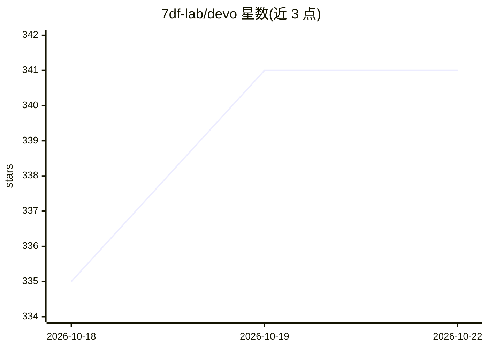

# 7df-lab/devo

⭐ 341 · Rust · MIT · 推送 2026-10-20 · [GitHub](https://github.com/7df-lab/devo) · [官网](https://devo.7df.ai/) · 组织维护 · 中文 README

**开源递归式编码 agent：持久 Python 工作区+子代理执行多步任务**

面向开发者的终端/桌面编码代理：本地 Rust 运行时驱动，通过 OpenAI 兼容或 Anthropic Messages API 接入自选模型（内置目录含 DeepSeek、Qwen、Kimi、GLM、MiniMax）。核心机制是持久 Python 工作区（ipython 工具跨调用保留变量与中间结果）、可委派子任务的子代理，以及 MCP、skills、权限与会话恢复。注意：pre-1.0，API 可能变动；OS 沙箱与权限选择器当前被临时禁用，进程以完整用户权限运行。

## 筛选速览

| 维度 | 判定 | 备注 |
|---|---|---|
| AI 角色 | `ai-native` | 本体是模型或模型工具 |
| 许可风险 | `permissive` | MIT |
| 部署形态 | `None` |  |
| 模型依赖 | locked-api |  |
| 硬件要求 | — | 无带数字的原话,不猜 |
| 安装摩擦 | `low` | 无编译、无系统依赖或容器化 |
| 成熟度 | `idea` | |

## 能力要点

- 持久 Python 工作区，ipython 工具跨调用保留变量与中间结果
- 子代理委派独立子任务，各自拥有会话与 Python 状态
- OpenAI 兼容（Chat Completions/Responses）与 Anthropic Messages API 接入
- 支持 MCP、skills、权限与可恢复会话

## 适用场景

- 用自选或本地模型执行多步编码任务
- 通过 Desktop 或终端 TUI/CLI 使用 agent
- 复用会话与中间结果跨步骤推进工作

## 场景标签

`编码 Agent` · 领域:编码与开发

## 证据(README 行号)

> L5: Devo tackles multi-step work with a **persistent Python workspace**, **child
> L6: agents**, and **your choice of model provider**. Use the Desktop app or terminal
> L67: Connect endpoints using **OpenAI-compatible Chat Completions**, **OpenAI-compatible

## 星数曲线

2026-10-18 335 → 2026-10-22 341（+6）

---
*卡片 v1 · prompt 1.4 · 生成 2026-10-21 · 置信度 high · 依据 README sha `e35d052c3a74` · [字段定义](../../DATASET.md)*
