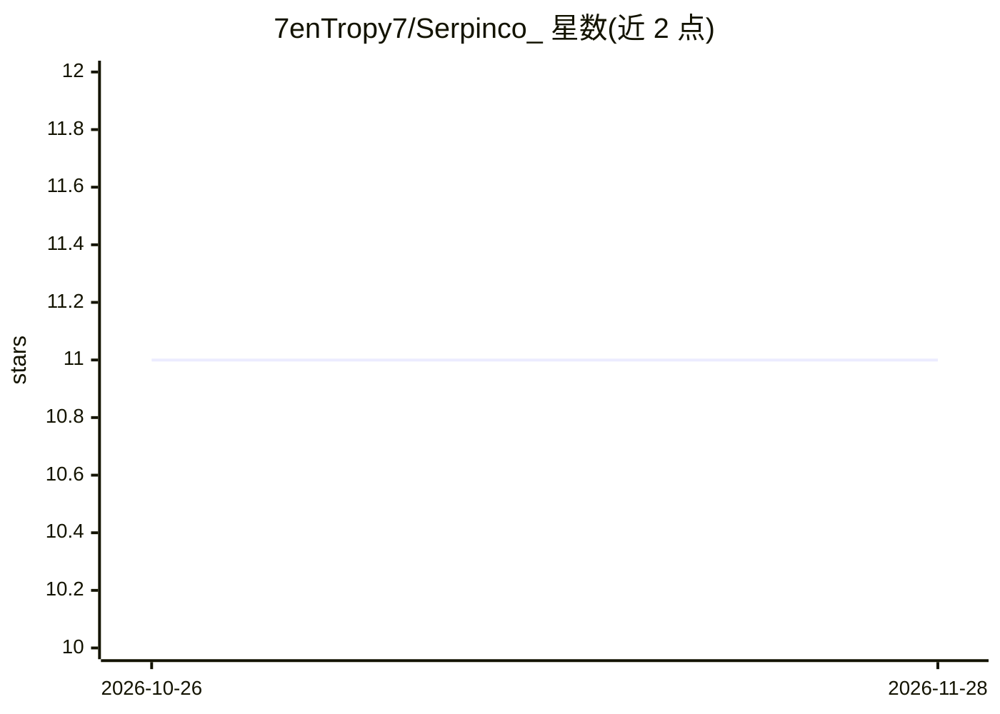

# 7enTropy7/Serpinco_

⭐ 11 · Python · GPL-3.0 · 推送 2026-04-14 · [GitHub](https://github.com/7enTropy7/Serpinco_) · 个人维护

**用 DQN 强化学习玩诺基亚贪吃蛇的 AI 智能体**

基于深度强化学习的贪吃蛇游戏智能体：游戏环境用 Pygame 实现，DQN 算法用 Keras 实现并训练。安装方式为 git clone 源码后通过 pip3 安装 requirements.txt 依赖，运行 snake.py 脚本启动，可调节速度（0-100）与是否渲染画面，由作者 Unnikrishnan Menon 以 GPL v3 许可发布。

## 筛选速览

| 维度 | 判定 | 备注 |
|---|---|---|
| AI 角色 | `ai-native` | 本体是模型或模型工具 |
| 许可风险 | `viral` | GPL-3.0 |
| 部署形态 | `library` | 以包/库形式分发 |
| 模型依赖 | — | README 未给出锁定关系 |
| 硬件要求 | — | 无带数字的原话,不猜 |
| 安装摩擦 | `low` | 无编译、无系统依赖或容器化 |
| 成熟度 | — | 结构信号不足 |

## 能力要点

- DQN 深度强化学习智能体玩游戏
- Pygame 游戏环境 + Keras 实现 DQN
- 支持调节速度（0-100）与渲染开关

## 适用场景

- 观看训练好的 AI 自动玩贪吃蛇
- 学习 DQN 强化学习的入门实现示例

## 场景标签

`强化学习` · 领域:训练与推理

## 证据(README 行号)

> L7: Code for a **Deep Reinforcement Learning** based A.I agent that plays the classic Nokia Snakes Game.
> L8: The game was developed using **Pygame** and the DQN algorithm was implemented using **Keras**.

## 星数曲线

2026-10-26 11 → 2026-11-28 11（+0）

---
*卡片 v1 · prompt 1.4 · 生成 2026-11-19 · 置信度 high · 依据 README sha `691074894288` · [字段定义](../../DATASET.md)*
