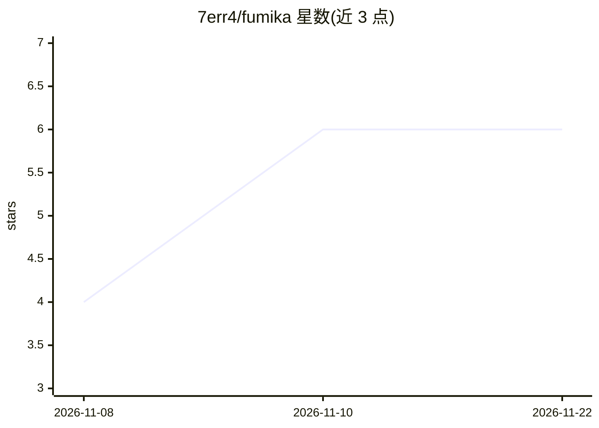

# 7err4/fumika

⭐ 6 · Python · NOASSERTION · 推送 2026-10-25 · [GitHub](https://github.com/7err4/fumika) · 个人维护

**本地漫画/图像生成与 LoRA 训练工作室（NVIDIA PC）**

Fumika 是一个在自有 PC 上运行（Windows/Linux，NVIDIA GPU）的本地工作室应用，捆绑自带 Python 的 ComfyUI 引擎，覆盖图像生成、漫画页生成、持久渲染队列、下载、项目与阅读器，并提供供 AI agent 调用的本地 MCP server。模型相关功能以插件形式提供（MOSS Doujin、多个 LoRA 训练器、Image/Asset Studio 等），首次启动按需下载所选插件模型。输出图片携带生成数据与 AI 标记（XMP/IPTC，符合 EU AI Act Art. 50），支持多语言界面。

## 筛选速览

| 维度 | 判定 | 备注 |
|---|---|---|
| AI 角色 | `ai-native` | 本体是模型或模型工具 |
| 许可风险 | `none` | NOASSERTION |
| 部署形态 | `desktop` | 安装包/桌面程序 |
| 模型依赖 | — | README 未给出锁定关系 |
| 硬件要求 | — | 无带数字的原话,不猜 |
| 安装摩擦 | `medium` | 含编译或系统依赖之一 |
| 成熟度 | `idea` | |

## 能力要点

- 捆绑自带 Python 的 ComfyUI 引擎，不改动系统环境
- 模型功能以插件形式按需安装下载
- 本地 MCP server 供 AI agent 调用
- 生成图片附带工作流数据与 AI 生成标记

## 适用场景

- 在本机生成漫画页和图片，无需云端服务
- 训练角色/风格/滑块 LoRA
- 通过 MCP 让 AI agent 调用本地图像管线

## 场景标签

`图像生成` `微调` · 领域:内容生成

## 证据(README 行号)

> L7: A local studio for comics, images and LoRA training on your own PC (Windows or Linux, NVIDIA GPU; no macOS). Fumika 
> L9: reader and a local MCP server for AI agents. Everything model-specific comes as a **plugin** - you pick the ones you
> L16: |MOSS Doujin|a story becomes finished comic pages with speech bubbles; the cleanest of 3 versions is kept|MOSS-Imag

## 星数曲线

2026-11-08 4 → 2026-11-22 6（+2）

---
*卡片 v1 · prompt 1.4 · 生成 2026-11-20 · 置信度 high · 依据 README sha `17b07f1c2203` · [字段定义](../../DATASET.md)*
