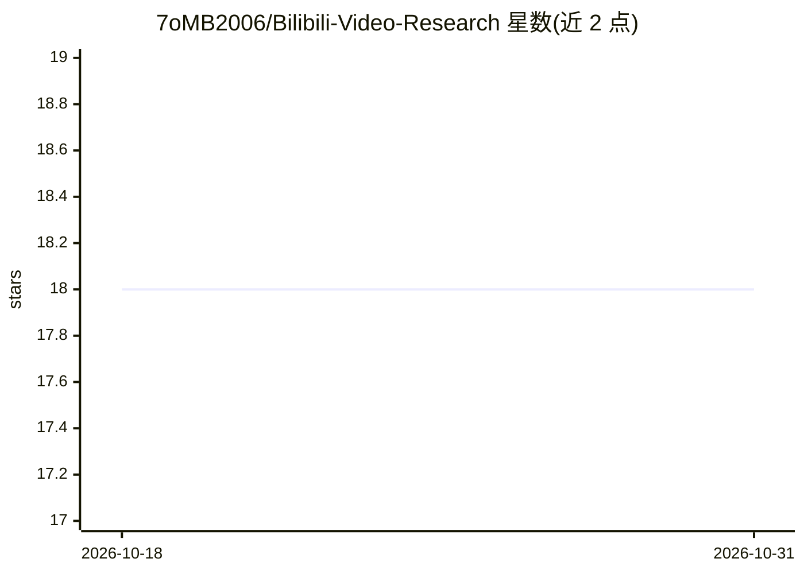

# 7oMB2006/Bilibili-Video-Research

⭐ 18 · TypeScript · MIT · 推送 2026-09-23 · [GitHub](https://github.com/7oMB2006/Bilibili-Video-Research) · 个人维护 · 中文 README

**面向 Codex/OpenCode 的 Bilibili 视频研究 MCP 服务器**

一个本地 MCP 服务器，把 Bilibili 视频链接经 language/vision/multimodal 三种证据模式转换为带溯源的研究报告：区分公开元数据、字幕或 ASR 转录、视频帧与不可信的社区评论，结果输出确定性的 VIDEO CONTEXT 块与 provenance。默认接入 StepFun 官方开放平台 API（vision/multimodal 用 step-3.7-flash，language 缺字幕时用 stepaudio-2.5-asr），可切换 Gemini。供 Codex、OpenCode、DeepSeek Harness、Step Code 等 MCP 客户端使用；需 Node.js 24+ 与 API key，FFmpeg 与 yt-dlp 由 npm 依赖自动携带。

## 筛选速览

| 维度 | 判定 | 备注 |
|---|---|---|
| AI 角色 | `ai-ecosystem` | LLM/agent 周边工具 |
| 许可风险 | `permissive` | MIT |
| 部署形态 | `None` |  |
| 模型依赖 | — | README 未给出锁定关系 |
| 硬件要求 | — | 无带数字的原话,不猜 |
| 安装摩擦 | `medium` | 含编译或系统依赖之一 |
| 成熟度 | — | 结构信号不足 |

## 能力要点

- language/vision/multimodal 三种证据模式按问题需要选择
- 结果携带 provenance 与确定性 VIDEO CONTEXT 块，区分元数据/字幕/帧/评论来源
- 默认 StepFun 开放平台 API，可选 Gemini，凭据缺失时报配置错误而非静默切换
- Bilibili 评论默认采样为不可信社区上下文，不作为已验证事实

## 适用场景

- 在 Codex/OpenCode 等客户端中让 agent 研究某个 Bilibili 视频内容
- 对教程/演示类视频提取画面中的框架与操作流程并附时间戳溯源
- 把讲解内容与画面内容分开核验，避免混用不同来源证据

## 场景标签

`多模态` `科研工具` · 领域:学习与行业

## 证据(README 行号)

> L9:  An evidence-aware Bilibili video research MCP for Codex, OpenCode, and other MCP-compatible clients.
> L34: |`language`|Bilibili captions when available; otherwise the selected provider's transcription/ASR path (`stepaudio-
> L100: **Requirements:** Node.js 24 or newer, a StepFun API key by default (or a Gemini API key

## 星数曲线

2026-10-18 18 → 2026-10-31 18（+0）

---
*卡片 v1 · prompt 1.4 · 生成 2026-10-29 · 置信度 high · 依据 README sha `f4bfe6951c07` · [字段定义](../../DATASET.md)*
