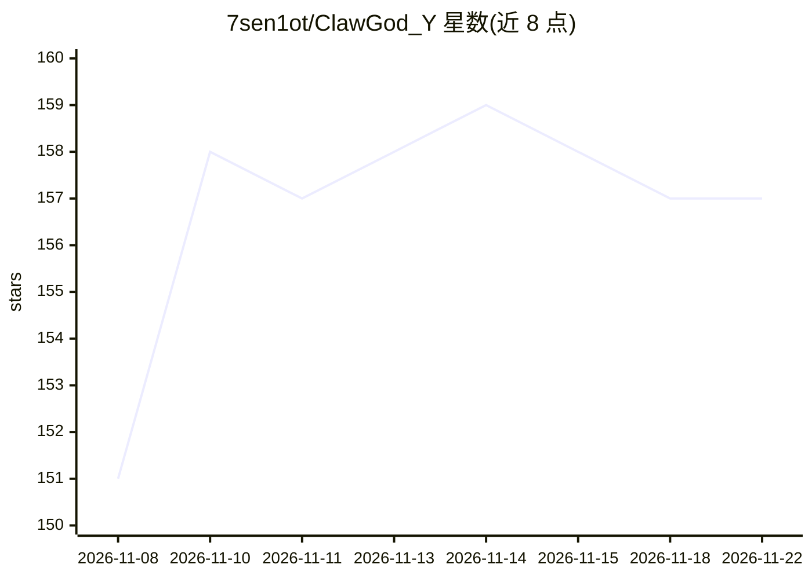

# 7sen1ot/ClawGod_Y

⭐ 157 · JavaScript · GPL-3.0 · 推送 2026-11-21 · [GitHub](https://github.com/7sen1ot/ClawGod_Y) · [官网](https://github.com/7sen1ot/ClawGod_Y) · 个人维护 · 中文 README

**给渗透测试者的 Claude Code 运行时补丁：绕过权限与安全限制**

Claude Code 官方 CLI 的运行时补丁项目（0Chencc/clawgod 的分支）：安装器提取官方二进制（默认 v2.1.322），施加 AST 级补丁后以 Bun 运行时在 ~/.clawgod 独立运行，不改动已装的 claude 命令。补丁默认绕过工具权限确认与安全分类器，重写提示词面向授权测试场景。模型接入通过 provider.json 配置 Anthropic 协议或 OpenAI 兼容服务，也可共享已有 Claude 订阅登录。跨版本兼容不保证，未匹配的必要补丁失败会中止安装。要求合法授权使用。

## 筛选速览

| 维度 | 判定 | 备注 |
|---|---|---|
| AI 角色 | `ai-ecosystem` | LLM/agent 周边工具 |
| 许可风险 | `viral` | GPL-3.0 |
| 部署形态 | `None` |  |
| 模型依赖 | — | README 未给出锁定关系 |
| 硬件要求 | — | 无带数字的原话,不猜 |
| 安装摩擦 | `low` | 无编译、无系统依赖或容器化 |
| 成熟度 | `idea` | |

## 能力要点

- 提取官方 Claude Code 二进制并施加 AST 级补丁，以 Bun 运行时独立运行于 ~/.clawgod
- 默认绕过工具权限确认与安全分类器，提示词面向授权渗透测试重写
- provider.json 支持 Anthropic 协议与 OpenAI Chat 兼容服务，或共享 Claude 订阅登录
- 补丁采用跨版本锚点，可选择 latest/stable/指定版本

## 适用场景

- 在已授权的渗透测试与安全审计中让 Claude Code 自动执行工具调用
- CTF 或实验环境中使用免确认的 Claude Code 会话
- 需要独立于原版 claude 的并行补丁运行时

## 场景标签

`编码 Agent` `网络安全` · 领域:编码与开发

## 证据(README 行号)

> L16: ClawGod_Y is a runtime patch for the official Claude Code CLI that turns it into a tool dedicated to authorized pen
> L23: - **Pentest-oriented patching**: tool-permission prompts and safety classifiers are bypassed by default, prompts ar

## 星数曲线

2026-11-08 151 → 2026-11-22 157（+6）

---
*卡片 v1 · prompt 1.4 · 生成 2026-11-17 · 置信度 high · 依据 README sha `b8aa6c24ab09` · [字段定义](../../DATASET.md)*
