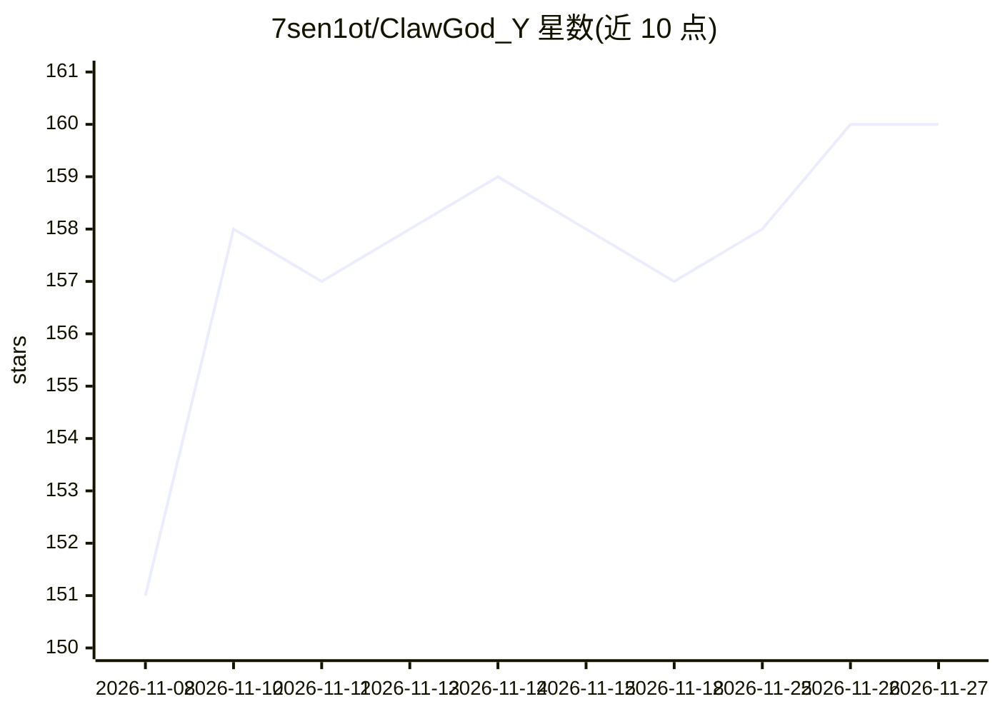

# 7sen1ot/ClawGod_Y

⭐ 160 · JavaScript · GPL-3.0 · 推送 2026-11-26 · [GitHub](https://github.com/7sen1ot/ClawGod_Y) · [官网](https://github.com/7sen1ot/ClawGod_Y) · 个人维护 · 中文 README

**对 Claude Code CLI 做运行时补丁，用于授权渗透测试**

对官方 Claude Code CLI 应用的运行时补丁工具：安装器提取官方二进制并做 AST 级补丁，用 Bun 运行修补后的构建。补丁默认绕过工具权限提示与安全分类器，将提示改写为授权测试场景，并裁剪未用的办公/消费功能。运行时独立存放于 ~/.clawgod，不改动已安装的原版 claude；通过 provider.json 支持 Anthropic 兼容 API、OpenAI Chat Completions 兼容服务或复用现有订阅登录。仅限授权测试用途，GPL-3.0 许可。

## 筛选速览

| 维度 | 判定 | 备注 |
|---|---|---|
| AI 角色 | `ai-ecosystem` | LLM/agent 周边工具 |
| 许可风险 | `viral` | GPL-3.0 |
| 部署形态 | `None` |  |
| 模型依赖 | — | README 未给出锁定关系 |
| 硬件要求 | — | 无带数字的原话,不猜 |
| 安装摩擦 | `low` | 无编译、无系统依赖或容器化 |
| 成熟度 | — | 结构信号不足 |

## 能力要点

- 对官方二进制做 AST 级补丁，运行时独立存放于 ~/.clawgod
- 默认绕过工具权限提示与安全分类器，提示改写为授权测试语境
- provider.json 支持 Anthropic 兼容与 OpenAI Chat Compatibles 兼容服务，或复用 Claude 订阅登录
- 跨版本补丁锚点，可选 latest/stable/指定版本安装

## 适用场景

- 在获得授权的渗透测试中运行补丁版 Claude Code
- 安全审计中跳过逐项工具权限确认
- 在同一台机器上并存原版 claude 与补丁版 clawgod

## 场景标签

`编码 Agent` `网络安全` · 领域:编码与开发

## 证据(README 行号)

> L15: ClawGod_Y is a runtime patch for the official Claude Code CLI that turns it into a tool dedicated to authorized pen
> L22: - **Pentest-oriented patching**: tool-permission prompts and safety classifiers are bypassed by default, prompts ar

## 星数曲线

2026-11-08 151 → 2026-11-27 160（+9）

---
*卡片 v1 · prompt 1.4 · 生成 2026-11-27 · 置信度 high · 依据 README sha `61e1cc8e0714` · [字段定义](../../DATASET.md)*
