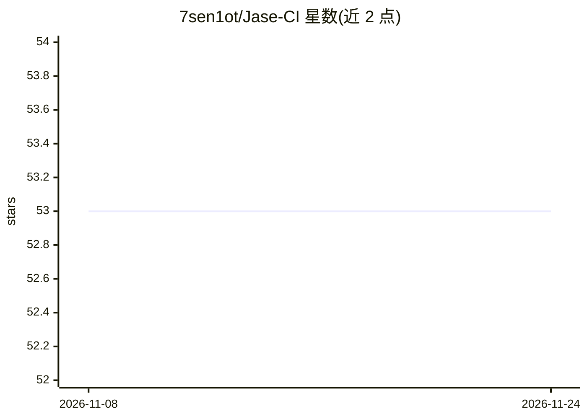

# 7sen1ot/Jase-CI

⭐ 53 · Python · NOASSERTION · 推送 2026-11-13 · [GitHub](https://github.com/7sen1ot/Jase-CI) · [官网](https://github.com/7sen1ot/Jase-CI) · 个人维护 · 中文 README

**给 LLM 应用做持续红队与延迟基准的 CI 流水线**

基于 promptfoo 构建的 GitHub Actions CI 流水线，对 OpenAI 兼容的客服 Agent（含工具调用/RAG/会话记忆）做自动化红队测试与双视角延迟基准。攻击生成、结果判定与目标 Agent 后端共用同一上游模型密钥（默认 DeepSeek，可经 UPSTREAM_* 替换）。security_gate.py 按策略文件做确定性裁决：整体攻击成功率上限 20%、零容忍插件单次命中即失败、蜜罐密钥断言；p95 预算超限同样导致流水线失败。无密钥时可运行离线自测。许可证为 PolyForm Noncommercial。

## 筛选速览

| 维度 | 判定 | 备注 |
|---|---|---|
| AI 角色 | `ai-ecosystem` | LLM/agent 周边工具 |
| 许可风险 | `none` | NOASSERTION |
| 部署形态 | `library` | 以包/库形式分发 |
| 模型依赖 | locked-api |  |
| 硬件要求 | — | 无带数字的原话,不猜 |
| 安装摩擦 | `low` | 无编译、无系统依赖或容器化 |
| 成熟度 | — | 结构信号不足 |

## 能力要点

- promptfoo 红队插件生成攻击用例，security_gate.py 按策略文件做确定性裁决
- 46 插件全量扫描 + 8 个自建创意攻击套件，按日定时与手动触发
- 双视角延迟基准（裸模型直连 vs 完整 Agent 链路），各设 p95 预算门禁
- 单一 UPSTREAM_API_KEY 驱动攻击生成、判定与 Agent 后端，离线模式无需密钥

## 适用场景

- 在 CI 中持续检测 LLM 应用的越狱、提示注入、RAG 泄露等风险
- 为 Agent 全链路设定并执行 p95 延迟预算门禁
- 无密钥环境下运行 mock 端到端自测与配置校验

## 场景标签

`网络安全` `LLM 可观测性` · 领域:评测与运维

## 证据(README 行号)

> L3: Continuous red-teaming + latency-benchmark CI for LLM apps, built on promptfoo. Attack generation, result judging an
> L17: Jase-CI turns red-teaming of an LLM app into a sustainable CI loop. The target is an OpenAI-compatible customer-ser

## 星数曲线

2026-11-08 53 → 2026-11-24 53（+0）

---
*卡片 v1 · prompt 1.4 · 生成 2026-11-18 · 置信度 mid · 依据 README sha `132bcc36fc79` · [字段定义](../../DATASET.md)*
