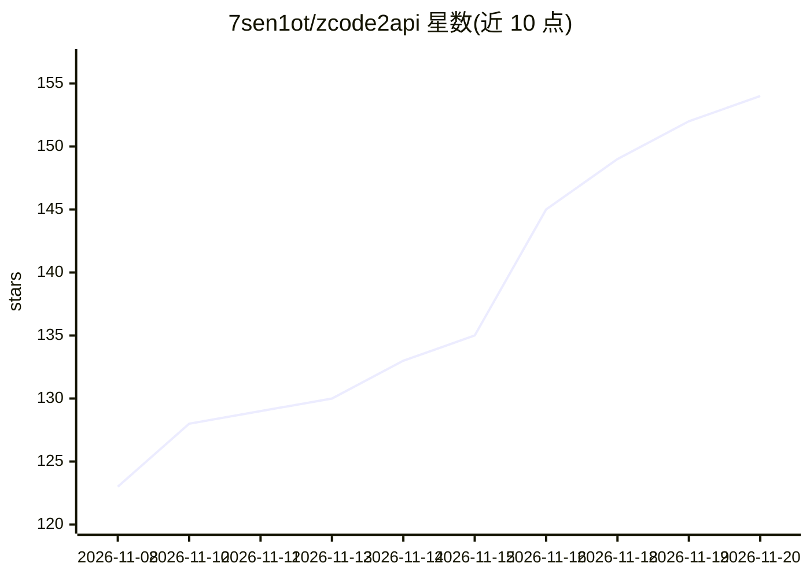

# 7sen1ot/zcode2api

⭐ 154 · Go · Apache-2.0 · 推送 2026-11-19 · [GitHub](https://github.com/7sen1ot/zcode2api) · [官网](https://github.com/7sen1ot/zcode2api) · 个人维护 · 中文 README

**ZCode 免费账号的反向代理网关，兼容 OpenAI/Anthropic 协议**

面向 ZCode（智谱/Z.ai）免费账号的 Go 反向代理网关，对外提供 OpenAI Chat Completions、Responses 与 Anthropic Messages 协议接口。核心机制围绕免费账号的并发与风控问题：多账号调度、自动领卡、错误分类与冷却重试；针对阿里云无痕验证 SDK 提供基于 Node.js+jsdom 的服务端自动取票验证（off/auto/always 三档策略），支持代理池与出口切换。提供 Web 控制台（账号、密钥、用量、日志管理）。非官方项目，验证结果由上游决定，不保证请求成功。

## 筛选速览

| 维度 | 判定 | 备注 |
|---|---|---|
| AI 角色 | `ai-ecosystem` | LLM/agent 周边工具 |
| 许可风险 | `permissive` | Apache-2.0 |
| 部署形态 | `desktop` | 安装包/桌面程序 |
| 模型依赖 | — | README 未给出锁定关系 |
| 硬件要求 | — | 无带数字的原话,不猜 |
| 安装摩擦 | `low` | 无编译、无系统依赖或容器化 |
| 成熟度 | — | 结构信号不足 |

## 能力要点

- 兼容 OpenAI Chat Completions、Responses 与 Anthropic Messages 协议
- 多账号调度、自动领卡与错误分类冷却重试
- 基于 Node.js+jsdom 的服务端 SDK 自动验证（off/auto/always 策略）
- Web 控制台管理账号、密钥、用量与日志

## 适用场景

- 把 ZCode 免费账号聚合为一个本地 API 网关供客户端调用
- 多免费账号并发调度与自动领卡
- 需要 OpenAI/Anthropic 协议兼容接口接入现有客户端

## 场景标签

`模型网关` · 领域:Agent 开发

## 证据(README 行号)

> L7: **ZCode(智谱、Zai）毒鸡蛋反代，让免费账号的重试、领卡和多账号管理交给网关。**
> L16: 面向 ZCode 免费账号的反向代理网关，兼容 OpenAI Chat Completions、Responses 和 Anthropic Messages 协议（推荐）。

## 星数曲线

2026-11-08 123 → 2026-11-20 154（+31）

---
*卡片 v1 · prompt 1.4 · 生成 2026-11-17 · 置信度 high · 依据 README sha `2cdc1beb1b9a` · [字段定义](../../DATASET.md)*
