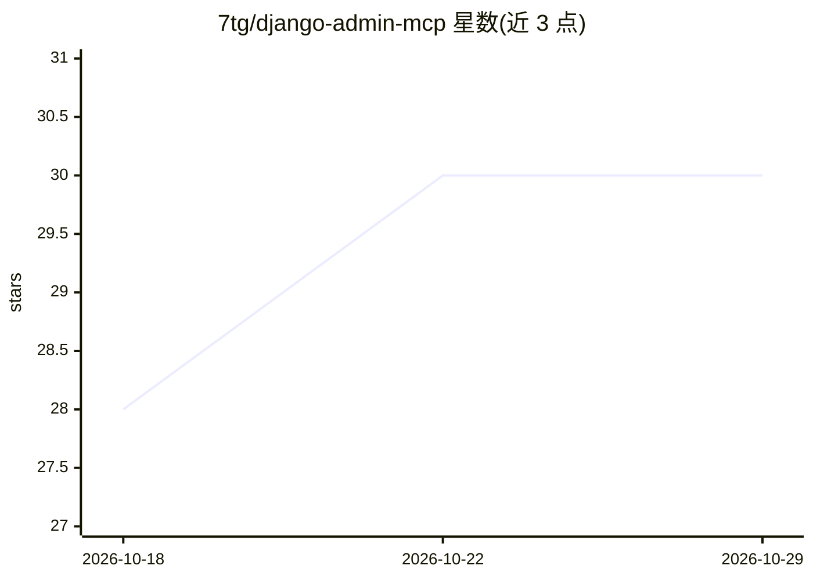

# 7tg/django-admin-mcp

⭐ 30 · Python · MIT · 推送 2026-10-27 · [GitHub](https://github.com/7tg/django-admin-mcp) · [官网](https://7tg.github.io/django-admin-mcp/) · 个人维护

**把 Django Admin 模型暴露为 MCP 工具的 Python 包**

Django 应用，向 ModelAdmin 添加一个 mixin 即可为 MCP 客户端生成 CRUD、admin actions、关系遍历、变更历史等工具。每次调用经过 ModelAdmin 权限检查与 full_clean 验证，操作写入 Django LogEntry 审计日志。令牌机制按用户绑定权限，支持过期与撤销，敏感字段可用 mcp_fields 排除。仅依赖 Django 与 Pydantic，通过 JSON-RPC 2.0 over HTTP 提供端点。面向在 Django 项目中接入 AI agent 的开发者。

## 筛选速览

| 维度 | 判定 | 备注 |
|---|---|---|
| AI 角色 | `ai-ecosystem` | LLM/agent 周边工具 |
| 许可风险 | `permissive` | MIT |
| 部署形态 | `library` | 以包/库形式分发 |
| 模型依赖 | — | README 未给出锁定关系 |
| 硬件要求 | — | 无带数字的原话,不猜 |
| 安装摩擦 | `low` | 无编译、无系统依赖或容器化 |
| 成熟度 | — | 结构信号不足 |

## 能力要点

- 从既有 ModelAdmin 自动生成 MCP 工具（CRUD/批量操作/admin actions）
- 所有调用经过 Django 权限检查与 full_clean 验证，写入 LogEntry 审计日志
- 令牌机制：每令牌独立权限、可过期、可撤销
- 仅依赖 Django 与 Pydantic，无 MCP SDK 或额外 HTTP 栈

## 适用场景

- 让 Claude 等 MCP 客户端在权限约束下操作 Django 管理后台数据
- 通过 admin actions 让 agent 执行发布、退款、导出 CSV 等既有操作
- 审计 AI agent 对数据的每一步变更

## 场景标签

`Agent 框架` · 领域:Agent 开发

## 证据(README 行号)

> L14: Add a mixin to your `ModelAdmin` and MCP clients get CRUD, admin actions and relationship traversal, inside Django'
> L64: **3. Point your MCP client at it**, for example in a `.mcp.json` for Claude Code:

## 星数曲线

2026-10-18 28 → 2026-10-29 30（+2）

---
*卡片 v1 · prompt 1.4 · 生成 2026-10-26 · 置信度 high · 依据 README sha `2450c79a859f` · [字段定义](../../DATASET.md)*
