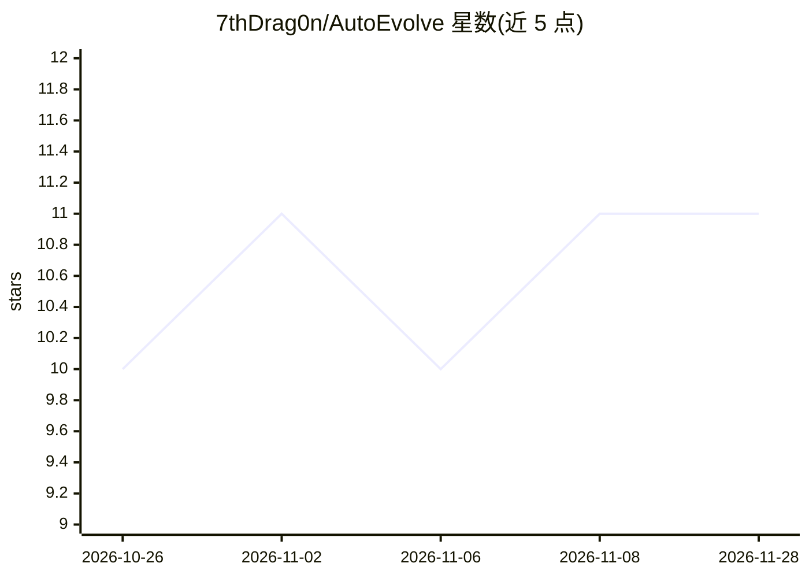

# 7thDrag0n/AutoEvolve

⭐ 11 · Python · GPL-3.0 · 推送 2026-11-18 · [GitHub](https://github.com/7thDrag0n/AutoEvolve) · 个人维护

**基于 LLM 的 FreqTrade 策略自进化交易机器人系统**

运行在 FreqTrade 之上的自动化策略迭代系统：每 60 秒读取 FreqTrade SQLite 数据库计算胜率、利润因子、夏普、回撤等指标，触发条件（连续亏损、利润回撤、策略闲置等）命中后进入进化循环——LLM 两阶段调用（先诊断、后改写策略代码），经校验与净化后通过热重载部署，观察后续 N 笔交易，表现低于阈值自动回滚上一代。提供 Streamlit 实时仪表盘、策略运行错误自动修复与 LLM 对话日志。README 声明为实验性软件，要求先以 dry-run 模式测试。

## 筛选速览

| 维度 | 判定 | 备注 |
|---|---|---|
| AI 角色 | `ai-native` | 本体是模型或模型工具 |
| 许可风险 | `viral` | GPL-3.0 |
| 部署形态 | `None` |  |
| 模型依赖 | local-ok | 支持本地模型 |
| 硬件要求 | — | 无带数字的原话,不猜 |
| 安装摩擦 | `low` | 无编译、无系统依赖或容器化 |
| 成熟度 | `idea` | |

## 能力要点

- 两阶段 LLM 进化：ANALYSE 诊断后 CODE 改写策略代码
- 五种触发条件（连续亏损/利润回撤/闲置/冷却/交易门槛）
- 部署后监控 N 笔交易，低于阈值自动回滚上一代
- 支持任意 OpenAI 兼容端点，含 Anthropic 直连与本地 Ollama

## 适用场景

- 让 LLM 持续迭代优化我的 FreqTrade 策略代码
- 在 dry-run 模式下自动测试多代策略并保留表现好的版本
- 通过仪表盘监控回撤触发条件与进化历史

## 场景标签

`金融量化` `编码 Agent` · 领域:编码与开发

## 证据(README 行号)

> L5: **AutoEvolve** is a self-improving trading bot system built on top of FreqTrade. It uses a large language model (LLM
> L20: 3. **Analyse** — The LLM receives the current strategy code, all performance metrics, recent trade history, and the
> L87: ### 🔌 LLM Provider Flexibility

## 星数曲线

2026-10-26 10 → 2026-11-28 11（+1）

---
*卡片 v1 · prompt 1.4 · 生成 2026-11-19 · 置信度 high · 依据 README sha `67dabe7157d6` · [字段定义](../../DATASET.md)*
