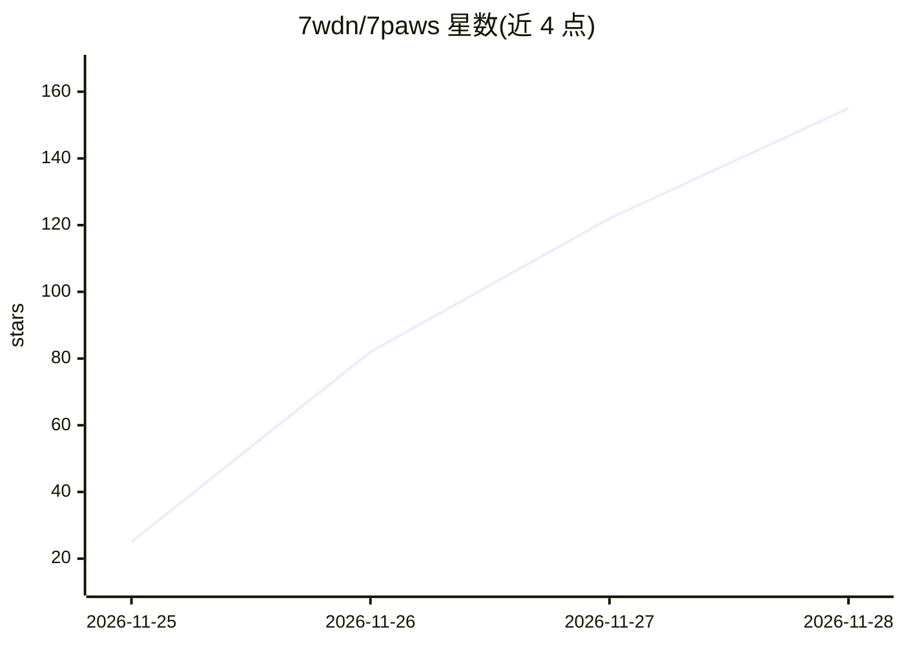

# 7wdn/7paws

⭐ 155 · Rust · MIT · 推送 2026-11-27 · [GitHub](https://github.com/7wdn/7paws) · 个人维护 · 中文 README

**Windows/macOS 3D 小猫桌宠：响应键鼠、AI 定制猫咪外观**

基于 Tauri 2 + Rust + three.js 的桌面宠物应用：全局监听键鼠输入驱动小猫动作（敲键抬爪、追光标、摸猫呼噜），支持点击穿透、始终置顶、全屏游戏置顶守卫、直播绿幕与定时语音提醒。用户可用照片取色或手调色槽创建自定义猫咪，也可通过内置 stdio MCP 服务让 AI 客户端生成配色、花纹与斑纹并热更新。提供 Windows x64/ARM64 安装包与 macOS DMG；发布包未签名，Windows 需 WebView2 Runtime，暂不支持 Linux。

## 筛选速览

| 维度 | 判定 | 备注 |
|---|---|---|
| AI 角色 | `ai-enhanced` | 去掉 AI 部分产品仍成立 |
| 许可风险 | `permissive` | MIT |
| 部署形态 | `desktop` | 安装包/桌面程序 |
| 模型依赖 | — | README 未给出锁定关系 |
| 硬件要求 | — | 无带数字的原话,不猜 |
| 安装摩擦 | `low` | 无编译、无系统依赖或容器化 |
| 成熟度 | — | 结构信号不足 |

## 能力要点

- 全局键鼠响应：无窗口焦点时打字/移动鼠标触发小猫动作
- 内置不依赖 Node/Python 的 stdio MCP 服务，AI 生成配色约 1 秒热更新
- 照片取色、异瞳色槽与花纹自定义，支持多只猫切换与毛色码导入导出
- 直播绿幕单窗口实现，OBS/直播姬色度键直接可用

## 适用场景

- 写代码或办公时在桌面养一只跟随键鼠动作的小猫
- 用自家猫咪照片生成同款配色的专属桌宠
- 直播时给小猫铺绿幕做窗口抠像采集
- 让 AI 客户端按文字描述捏出指定花纹的猫

## 场景标签

 · 领域:桌面工具/个性化

## 证据(README 行号)

> L3:  Windows 与 macOS 的 3D 桌面小猫桌宠 全局键鼠响应 · 照片或 AI 定制专属猫咪 · 摸猫呼噜 · 点击穿透
> L144: ## AI 助手接入（MCP）
> L233: - **桌面壳** — Tauri 2 + Rust；全局键鼠钩子、窗口、托盘、点击穿透和设置持久化。

## 星数曲线

2026-11-25 25 → 2026-11-28 155（+130）

---
*卡片 v1 · prompt 1.4 · 生成 2026-11-28 · 置信度 mid · 依据 README sha `29e0eaf8a6c4` · [字段定义](../../DATASET.md)*
