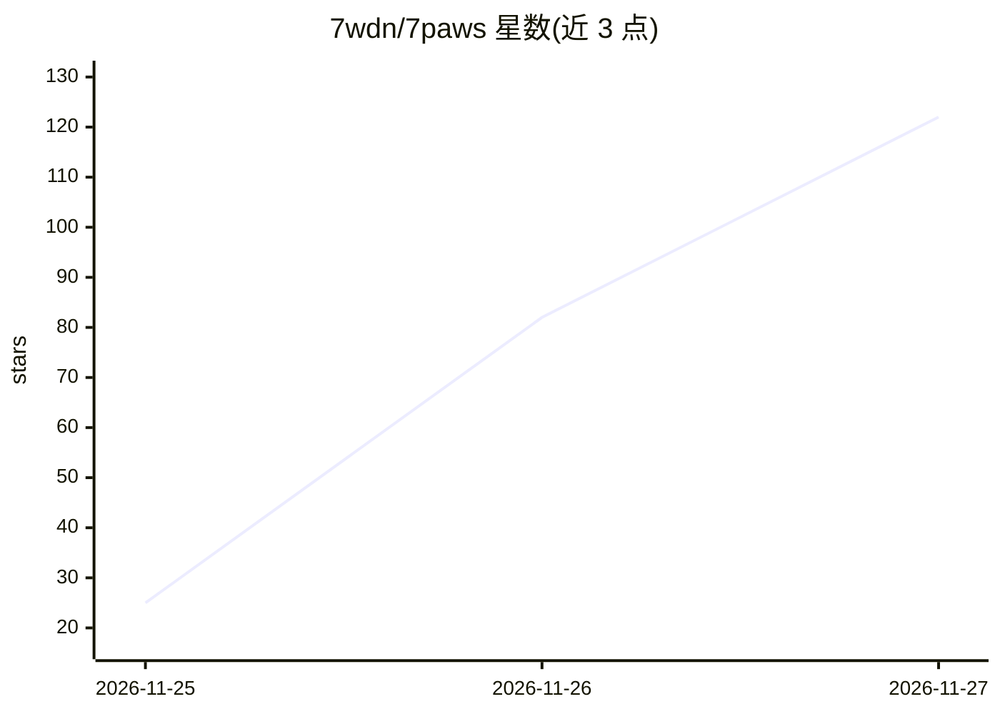

# 7wdn/7paws

⭐ 122 · Rust · MIT · 推送 2026-11-26 · [GitHub](https://github.com/7wdn/7paws) · 个人维护 · 中文 README

**Windows/macOS 的 3D 桌宠小猫，支持键鼠互动与 AI 定制配色**

基于 Tauri 2 + Rust、three.js/WebGL 的桌面宠物应用，小猫响应全局键鼠事件：敲键抬爪、追光标、伸爪够鼠标、闲置睡觉，支持摸猫呼噜（WebAudio 合成）、点击穿透、键盘布局切换与设置持久化。用户可通过照片取色或手调色槽定制「我的猫」，也可通过内置的 stdio MCP 服务让 AI 客户端生成配色、花纹与斑纹并热更新。发布于 GitHub Releases，含 Windows x64/ARM64 安装包与便携版、macOS 双架构 DMG，包未签名未公证。

## 筛选速览

| 维度 | 判定 | 备注 |
|---|---|---|
| AI 角色 | `ai-enhanced` | 去掉 AI 部分产品仍成立 |
| 许可风险 | `permissive` | MIT |
| 部署形态 | `desktop` | 安装包/桌面程序 |
| 模型依赖 | — | README 未给出锁定关系 |
| 硬件要求 | — | 无带数字的原话,不猜 |
| 安装摩擦 | `low` | 无编译、无系统依赖或容器化 |
| 成熟度 | — | 结构信号不足 |

## 能力要点

- 全局键鼠响应：任意应用下敲键抬爪、看光标、伸爪够鼠标，闲置睡觉
- 内置不依赖 Node/Python 的 stdio MCP 服务，AI 生成配色与斑纹约 1 秒热更新
- 照片取色、手调色槽与毛色码导入导出，可创建多只自定义猫
- 点击穿透、隐私模式、WebAudio 合成呼噜声，无音频资源

## 适用场景

- 想要一只跟随打字和鼠标动作的桌面小猫
- 用自家猫咪照片取色，捏一只专属配色的小猫
- 通过 Claude Code 等 AI 客户端用对话或照片定制猫咪外观

## 场景标签

 · 领域:桌面工具/个性化

## 证据(README 行号)

> L3:  Windows 与 macOS 的 3D 桌面小猫桌宠 全局键鼠响应 · 照片或 AI 定制专属猫咪 · 摸猫呼噜 · 点击穿透
> L111: ## AI 助手接入（MCP）
> L113: 7paws 内置一个不依赖 Node/Python 的 stdio MCP 服务。照片由你发给 AI 客户端，AI 读取后生成配色、花纹和斑纹，运行中的小猫约 1 秒内热更新，无需重启。

## 星数曲线

2026-11-25 25 → 2026-11-27 122（+97）

---
*卡片 v1 · prompt 1.4 · 生成 2026-11-24 · 置信度 mid · 依据 README sha `c3b6af91cd68` · [字段定义](../../DATASET.md)*
