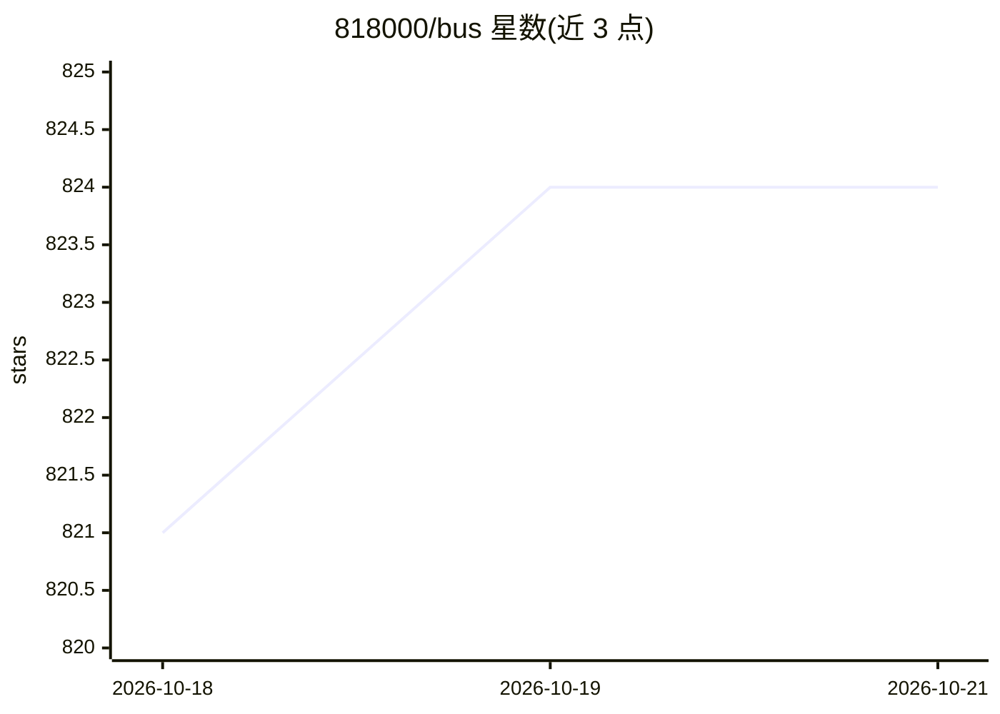

# 818000/bus

⭐ — · [GitHub]() · 个人维护 · 中文 README

**Java 企业级应用/服务全栈框架与组件套件**

Bus 是基于 Java 17+（8.x 版本编译目标 Java 21）的轻量级企业应用/服务框架，以 bus-* 模块化组件套件形式提供：统一认证（OIDC/OAuth2/SAML）、分布式缓存、限流、日志、MyBatis 增强、支付聚合、对象存储、分布式任务调度、WebFlux 反应式网关等 30 余个模块，可整体（bus-all）或按组件引入，与 Spring Boot 集成。其中 AI 相关功能包括 bus-cortex 的 MCP/Prompt 注册中心、bus-opencv 封装 OpenCV 的图像识别/人脸检测、bus-metrics 的 LLM 可观测性及 bus-image 的 OCR，框架本体为非 AI 产品。

## 筛选速览

| 维度 | 判定 | 备注 |
|---|---|---|
| AI 角色 | `ai-enhanced` | 去掉 AI 部分产品仍成立 |
| 许可风险 | `permissive` | — |
| 部署形态 | `None` |  |
| 模型依赖 | — | README 未给出锁定关系 |
| 硬件要求 | — | 无带数字的原话,不猜 |
| 安装摩擦 | `medium` | 含编译或系统依赖之一 |
| 成熟度 | — | 结构信号不足 |

## 能力要点

- 30+ 模块化组件，支持 Maven/Gradle 按需引入
- bus-auth 支持 OIDC/OAuth2/SAML 并集成 15+ 第三方登录
- bus-cortex 提供 MCP/Prompt 统一注册与配置中心
- bus-opencv 封装 OpenCV 提供图像识别/人脸检测/视频分析

## 适用场景

- 快速搭建包含认证、缓存、限流、支付等能力的微服务后端
- 按需引入单一组件（如限流、日志脱敏、Office 文档处理）到现有 Spring Boot 项目
- 为 AI 服务提供 MCP/Prompt 注册与健康探测管理

## 场景标签

`人脸识别` `OCR` `LLM 可观测性` · 领域:评测与运维

## 证据(README 行号)

> L24: Bus (Enterprise Application/Service Bus) is a foundational framework and service suite; a lightweight enterprise-le
> L25: application/service framework built on Java 17+, providing standardized service suites and distributed middleware
> L67: |[√]|bus-opencv|Computer vision library, wrapping OpenCV to provide image recognition/face detection/video analysis

## 星数曲线

2026-10-18 821 → 2026-10-21 824（+3）

---
*卡片 v1 · prompt 1.4 · 生成 2026-10-21 · 置信度 mid · 依据 README sha `ac5f77dcadcb` · [字段定义](../../DATASET.md)*
