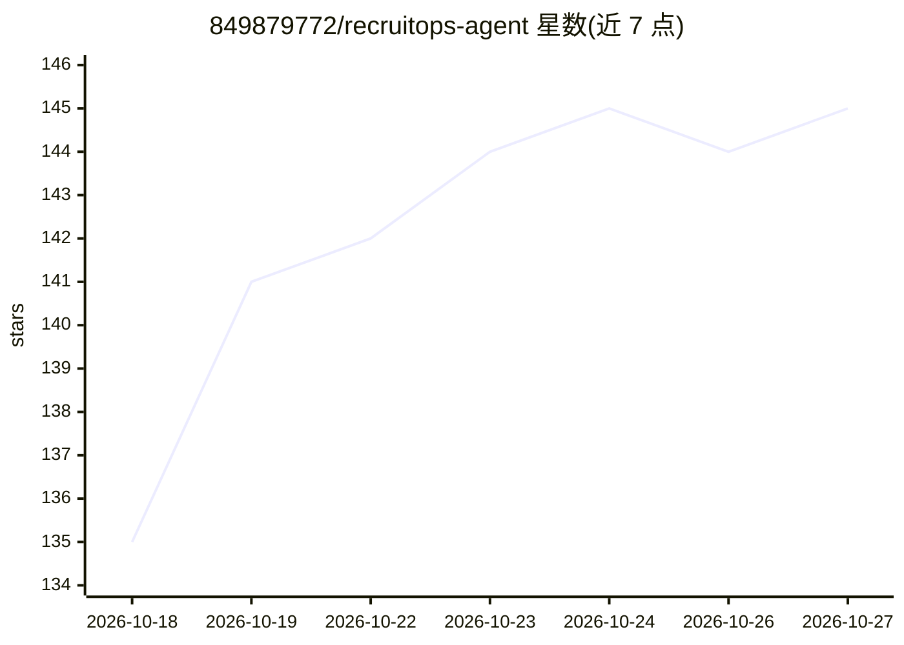

# 849879772/recruitops-agent

⭐ 145 · Python · MIT · 推送 2026-10-07 · [GitHub](https://github.com/849879772/recruitops-agent) · 个人维护 · 中文 README

**面向校园招聘的 Windows 桌面求职助手：发现岗位、匹配评分、辅助投递**

面向校招求职者的 Windows 桌面软件（Electron + FastAPI + PostgreSQL），功能覆盖从 OfferBiu 等来源抓取校招岗位、按简历关键词筛选与补全 JD、基于简历事实做匹配评分并解释优势不足、内置浏览器保留登录并做简历闪填（最终提交由用户完成）、维护投递记录并只升不降地复核进度、只读 IMAP 同步招聘邮件识别笔试面试拒信、生成日程待办，并提供自然语言求职助理与每日定时任务。模型侧仅支持 DeepSeek 官方接口（不再支持第三方 OpenAI 兼容服务），用于简历解析、评分、邮件理解与工具调用。数据保存在本地 .data 目录。

## 筛选速览

| 维度 | 判定 | 备注 |
|---|---|---|
| AI 角色 | `ai-enhanced` | 去掉 AI 部分产品仍成立 |
| 许可风险 | `permissive` | MIT |
| 部署形态 | `desktop` | 安装包/桌面程序 |
| 模型依赖 | locked-api |  |
| 硬件要求 | — | 无带数字的原话,不猜 |
| 安装摩擦 | `low` | 无编译、无系统依赖或容器化 |
| 成熟度 | — | 结构信号不足 |

## 能力要点

- 抓取岗位列表并按简历关键词筛选、补全 JD、生成匹配评分与优劣势解释
- 内置招聘浏览器：站点隔离登录、表单扫描与简历闪填，最终提交由用户完成
- 只读 IMAP 同步招聘邮件，识别投递/测评/笔试/面试/拒信并生成日程待办
- 投递进度状态只升不降，邮件与官网证据不足时不覆盖已确认进度

## 适用场景

- 校招期间集中发现、筛选并跟踪目标岗位
- 在内置浏览器中登录招聘官网并快速填写表单
- 自动同步招聘邮件，把笔试面试时间汇总为日程

## 场景标签

`浏览器自动化` `RAG` `AI 助手` · 领域:效率与自动化

## 证据(README 行号)

> L3: > 一个面向校园招聘的 Windows 桌面软件：发现和筛选岗位、补全 JD、匹配评分、辅助投递、维护投递进度、处理招聘邮件，并把笔试、面试和待办统一到一处。
> L299: 核心岗位、投递、邮件和日程使用结构化数据库查询；模型主要负责简历解析、岗位评分、邮件理解和工具调用。

## 星数曲线

2026-10-18 135 → 2026-10-27 145（+10）

---
*卡片 v1 · prompt 1.4 · 生成 2026-10-23 · 置信度 mid · 依据 README sha `1d9ba927b85e` · [字段定义](../../DATASET.md)*
