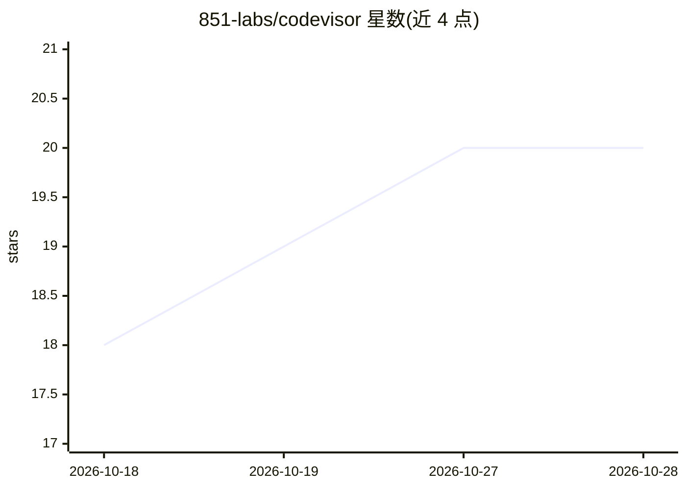

# 851-labs/codevisor

⭐ 20 · Swift · AGPL-3.0 · 推送 2026-10-27 · [GitHub](https://github.com/851-labs/codevisor) · [官网](https://codevisor.dev) · 组织维护

**在 macOS 上运行多种编码 agent 的原生桌面客户端**

Codevisor 是一个原生 macOS 桌面应用（纯 Swift 编写，无 Electron），用于在一个应用内运行 Claude Code、Codex、Pi 及任何兼容 ACP（Agent Client Protocol）的编码 agent。功能包括连接远程机器（Mac Mini、VPS 等）、内嵌 Ghostty 终端、跨项目查看 agent 会话，插件面板以受控 webview 渲染。通过安装脚本、Homebrew cask 或直接下载 dmg 安装；Linux 可安装 Codevisor Server。采用 AGPL-3.0 许可。

## 筛选速览

| 维度 | 判定 | 备注 |
|---|---|---|
| AI 角色 | `ai-ecosystem` | LLM/agent 周边工具 |
| 许可风险 | `viral` | AGPL-3.0 |
| 部署形态 | `None` |  |
| 模型依赖 | — | README 未给出锁定关系 |
| 硬件要求 | — | 无带数字的原话,不猜 |
| 安装摩擦 | `low` | 无编译、无系统依赖或容器化 |
| 成熟度 | — | 结构信号不足 |

## 能力要点

- 单一原生应用运行 Claude Code、Codex、Pi 及 ACP 兼容编码 agent
- 支持连接远程机器（Mac Mini、VPS、远程服务器）
- 内嵌 Ghostty 终端
- 纯 Swift 原生实现，无 Electron

## 适用场景

- 同时管理多个项目中的编码 agent 会话
- 在远程服务器或 Mac Mini 上运行编码 agent
- 在原生 macOS 应用中替代网页端操作 agent

## 场景标签

`编码 Agent` · 领域:编码与开发

## 证据(README 行号)

> L32: **Run Claude Code, Codex, Pi, and any ACP-compatible coding agent on your machines in one native macOS app.**
> L34: - **lightweight and fast** — no electron bloat, no webviews, pure Swift. (the one deliberate exception: plugin pane

## 星数曲线

2026-10-18 18 → 2026-10-28 20（+2）

---
*卡片 v1 · prompt 1.4 · 生成 2026-10-28 · 置信度 mid · 依据 README sha `c5628a794420` · [字段定义](../../DATASET.md)*
