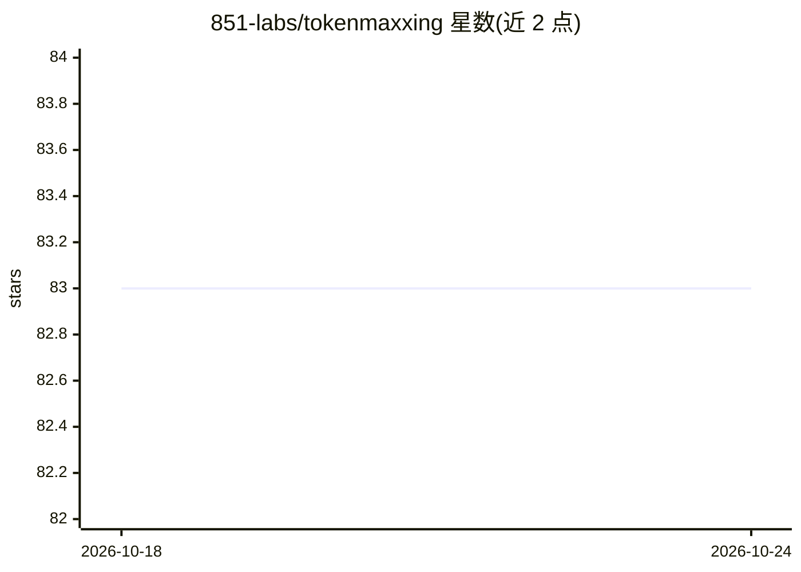

# 851-labs/tokenmaxxing

⭐ 83 · TypeScript · MIT · 推送 2026-10-17 · [GitHub](https://github.com/851-labs/tokenmaxxing) · [官网](https://tokenmaxxing.sh) · 组织维护

**本地 CLI：汇总编码 agent 的 token 用量并同步到公开排行榜**

基于 ccusage 构建的命令行工具：读取本机 19 种编码 agent（Claude Code、OpenAI Codex、OpenCode、Gemini CLI 等）的用量数据，生成每日 token 数与 API 等价花费聚合值，同步到公开的个人主页与排行榜，支持 7 天/30 天/全部时间对比。同步幂等、跨设备聚合，后台服务支持 macOS/Linux/Windows。仅上传日聚合数据（日期、模型名、agent 名、token 数、花费），不上传提示词、代码或会话内容，可用 --dry-run 预览载荷。通过 npm 全局安装。

## 筛选速览

| 维度 | 判定 | 备注 |
|---|---|---|
| AI 角色 | `ai-ecosystem` | LLM/agent 周边工具 |
| 许可风险 | `permissive` | MIT |
| 部署形态 | `library` | 以包/库形式分发 |
| 模型依赖 | — | README 未给出锁定关系 |
| 硬件要求 | — | 无带数字的原话,不猜 |
| 安装摩擦 | `low` | 无编译、无系统依赖或容器化 |
| 成熟度 | — | 结构信号不足 |

## 能力要点

- 读取 19 种编码 agent 的本地用量数据
- 生成日 token 与 API 等价花费聚合并同步公开排行榜
- 同步幂等、跨设备聚合，支持 --dry-run 预览上传内容
- 仅上传日聚合数据，不含提示词、代码或会话内容

## 适用场景

- 追踪我在各编码 agent 上的 token 花费
- 与他人对比 token 用量或 API 等价花费
- 多台机器自动聚合用量到统一个人主页

## 场景标签

 · 领域:开发者工具/AI 用量监控

## 证据(README 行号)

> L41: tokenmaxxing uses ccusage to read local coding-agent
> L43: aggregates to your public profile. The leaderboard lets you compare spend or

## 星数曲线

2026-10-18 83 → 2026-10-24 83（+0）

---
*卡片 v1 · prompt 1.4 · 生成 2026-10-24 · 置信度 high · 依据 README sha `82bb897fe67d` · [字段定义](../../DATASET.md)*
