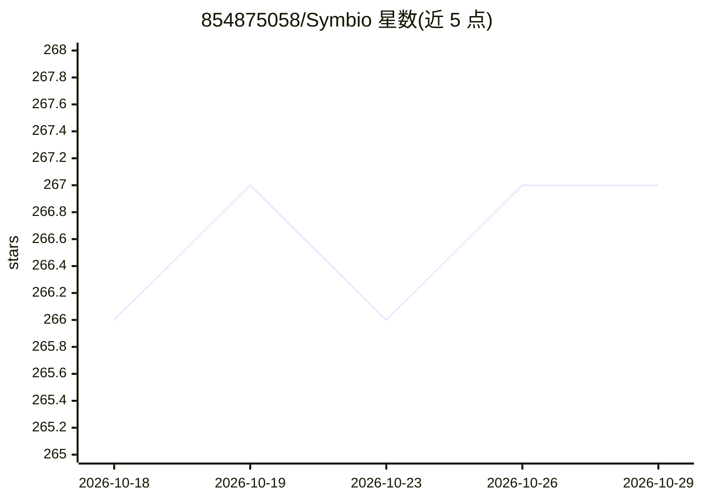

# 854875058/Symbio

⭐ 267 · Python · MIT · 推送 2026-07-29 · [GitHub](https://github.com/854875058/Symbio) · [官网](https://github.com/854875058/Symbio) · 个人维护 · 中文 README

**多 Agent 协同运行时：调度、审批、沙箱、记忆与成本一体化框架**

Python 3.10+ 实现的多 Agent 协同框架，把调度（动态 DAG、Planner/Reviewer）、本体记忆图谱、HITL 多渠道审批（微信/飞书/钉钉/Telegram 等）、Prompt Injection 防火墙、Token 成本优化（语义缓存/上下文剪枝）、本地与 Docker 容器沙箱、数据飞轮（含 LoRA SFT 训练后端）整合在同一运行时，并提供 FastAPI 后端、18 页面 Web UI、CLI 与 API。支持 MCP、A2A 协议及委托本地 Claude Code / Codex CLI 执行。自述处于 Alpha 阶段，K8s 执行与跨机联邦学习等仍在实现中。

## 筛选速览

| 维度 | 判定 | 备注 |
|---|---|---|
| AI 角色 | `ai-ecosystem` | LLM/agent 周边工具 |
| 许可风险 | `permissive` | MIT |
| 部署形态 | `library` | 以包/库形式分发 |
| 模型依赖 | locked-api |  |
| 硬件要求 | — | 无带数字的原话,不猜 |
| 安装摩擦 | `low` | 无编译、无系统依赖或容器化 |
| 成熟度 | `idea` | |

## 能力要点

- 动态 DAG 运行时：任务为可持久化执行图，支持重规划与断点恢复
- 运行时自带能力账本 API，区分已实现/部分实现/规划中
- HITL 审批覆盖 6+ IM 渠道并带超时升级策略
- Docker 容器沙箱：默认断网、只读根文件系统、资源限额

## 适用场景

- 搭建需要人工审批与沙箱隔离的多 Agent 工作流
- 通过微信/飞书等 IM 远程审批 Agent 的高危操作
- 对 Agent 运行轨迹做数据飞轮蒸馏与 LoRA 微调
- 统一登记并管控本地 Claude Code / Codex 会话

## 场景标签

`多智能体` `微调` `Agent 记忆` · 领域:Agent 开发

## 证据(README 行号)

> L7: 把 Agent 能力拆成*可观测、可审批、可恢复、可验证*的基础设施模块 —— 调度、记忆、审批、安全、成本、沙箱、外部工具接管和数据飞轮，都在同一个运行时里协作。
> L20: 很多 Agent 项目只解决"让模型调用工具"这一层。Symbio 关心的是更靠后、也更难的工程问题：
> L137: |调度中枢|任务理解、DAG 编排、模型路由、风险判断|Orchestrator、DAG Runtime、Router、Planner/Reviewer|

## 星数曲线

2026-10-18 266 → 2026-10-29 267（+1）

---
*卡片 v1 · prompt 1.4 · 生成 2026-10-22 · 置信度 high · 依据 README sha `11f017aebf77` · [字段定义](../../DATASET.md)*
