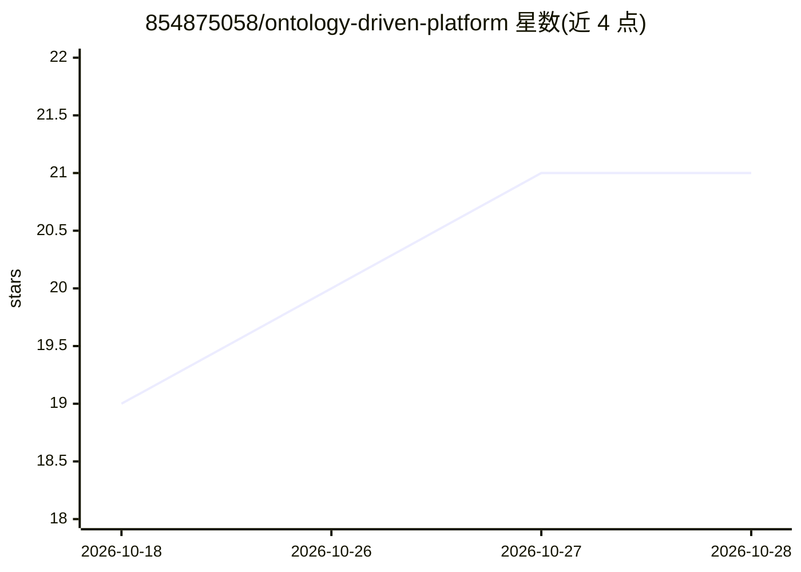

# 854875058/ontology-driven-platform

⭐ 21 · Vue · 推送 2026-06-08 · [GitHub](https://github.com/854875058/ontology-driven-platform) · [官网](https://github.com/854875058/ontology-driven-platform) · 个人维护 · 中文 README

**企业级本体智能平台：数据治理、本体建模到智能体编排**

面向企业数据与 AI 团队的端到端平台：通过统一连接器接入 MySQL、PostgreSQL、Hive、Kafka 等多源数据，基于 W3C OWL 2 标准进行实体/属性/关系建模，支持文档抽取（LLM 流式抽取）、模板实例化、AI 对话、手动录入四种建模方式，经构建→审核→注水→发布流水线（含 7 项质量门禁）上线。上层提供 ReAct 循环智能体编排、技能管理、可视化流程编辑、Copilot 对话助手与全链路追踪。前后端分离架构（Vue 3 + FastAPI），开发环境默认 SQLite，可选 MySQL/Neo4j/Redis。

## 筛选速览

| 维度 | 判定 | 备注 |
|---|---|---|
| AI 角色 | `ai-ecosystem` | LLM/agent 周边工具 |
| 许可风险 | `none` | — |
| 部署形态 | `library` | 以包/库形式分发 |
| 模型依赖 | — | README 未给出锁定关系 |
| 硬件要求 | — | 无带数字的原话,不猜 |
| 安装摩擦 | `low` | 无编译、无系统依赖或容器化 |
| 成熟度 | — | 结构信号不足 |

## 能力要点

- 对齐 W3C OWL 2 的本体建模与版本化发布流水线
- 多源异构连接器（MySQL/PostgreSQL/Oracle/Hive/ClickHouse/S3/Kafka 等）
- ReAct 循环 Agent 编排、技能管理与工具调用追踪
- 文档抽取、AI 对话、模板、手动四种建模方式，LLM 辅助映射与注水验证

## 适用场景

- 把分散的企业数据资产统一为本体语义网络并治理发布
- 基于治理后的业务语义构建智能体应用与自动化场景
- 字段级数据血缘追踪与声明式质量规则监控

## 场景标签

`知识图谱` `Agent 框架` · 领域:Agent 开发

## 证据(README 行号)

> L18: 元枢本体将分散在各系统中的企业数据资产转化为统一、可查询、可执行的语义网络。平台提供从**数据接入**到**本体建模**再到**智能体应用**的端到端工作流，让团队基于治理良好的业务语义构建智能场景，而非直接操作裸表和脚本。
> L25: - **智能体编排** — ReAct 循环 Agent，工具调用、技能管理、场景自动化，全链路执行追踪
> L69: |智能体管理|创建、配置、部署 ReAct 循环 Agent，注入本体上下文|

## 星数曲线

2026-10-18 19 → 2026-10-28 21（+2）

---
*卡片 v1 · prompt 1.4 · 生成 2026-10-28 · 置信度 mid · 依据 README sha `6d7be80d81e5` · [字段定义](../../DATASET.md)*
