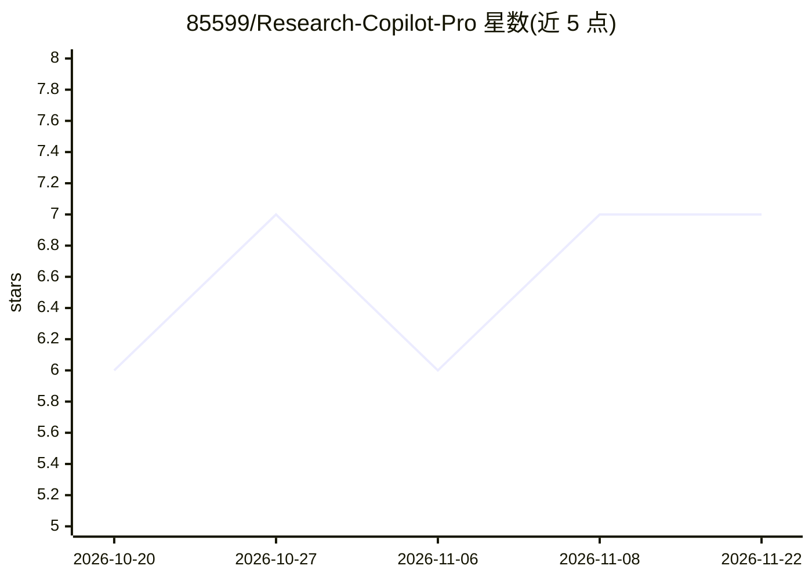

# 85599/Research-Copilot-Pro

⭐ 7 · Python · MIT · 推送 2026-10-08 · [GitHub](https://github.com/85599/Research-Copilot-Pro) · 个人维护

**面向印度股市的多智能体研究终端，产出评级交易建议**

面向印度市场的股票研究终端：聚合 NSE/BSE 实时行情、覆盖 Nifty 50、Bank Nifty、Sensex 等指数，并以纯 Python 计算的规则量化筛选（EMA/RSI/MACD/ATR 与因子分）。核心是一条 TradingAgents 式多智能体流水线：四名分析师并行→多空辩论→研究经理→交易员→风险辩论→投资组合经理，最终输出 5 档评级与入场/止损/目标位及仓位检查；每个数字由代码计算，LLM 仅做解读。README 标注为教育用途、非投资建议，行情来源为非官方端点。

## 筛选速览

| 维度 | 判定 | 备注 |
|---|---|---|
| AI 角色 | `ai-native` | 本体是模型或模型工具 |
| 许可风险 | `permissive` | MIT |
| 部署形态 | `library` | 以包/库形式分发 |
| 模型依赖 | local-ok | 支持本地模型 |
| 硬件要求 | — | 无带数字的原话,不猜 |
| 安装摩擦 | `low` | 无编译、无系统依赖或容器化 |
| 成熟度 | — | 结构信号不足 |

## 能力要点

- 多智能体流水线：分析师并行→多空辩论→风险辩论→组合经理终评，输出 5 档评级与仓位检查
- 规则量化筛选在 Python 中计算，无 LLM 参与；LLM 只引用代码验证过的数字
- 每笔建议记录来源与决策日志，持有期后按 Nifty/Sensex 打分并反思反哺后续提示
- 按请求截断报告与辩论历史，规避免费 LLM 档位的 413 限流

## 适用场景

- 查看印度 NSE/BSE 个股与指数的实时行情和量化筛选
- 用多智能体辩论流程生成带评级的个股研究建议
- 查阅历史运行的完整报告树进行复盘

## 场景标签

`多智能体` `金融量化` · 领域:Agent 开发

## 证据(README 行号)

> L3: **An Indian-market research terminal with a TradingAgents-style multi-agent desk.**
> L28: - **Multi-agent AI research.** A TradingAgents-style pipeline: four analysts in parallel →
> L38: - **Provenance.** Every number is computed by code; the LLM only interprets. Each run records which

## 星数曲线

2026-10-20 6 → 2026-11-22 7（+1）

---
*卡片 v1 · prompt 1.4 · 生成 2026-11-21 · 置信度 mid · 依据 README sha `a6f1ef6d0ee0` · [字段定义](../../DATASET.md)*
