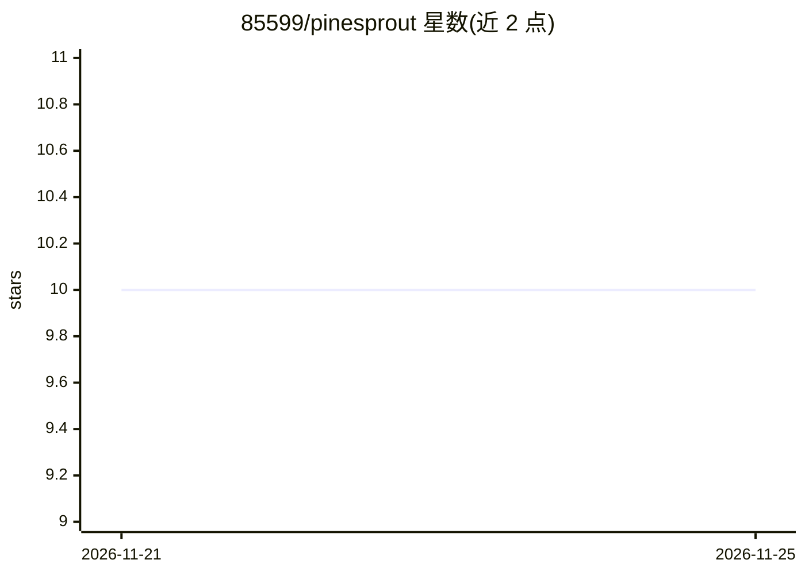

# 85599/pinesprout

⭐ 10 · Python · MIT · 推送 2026-10-26 · [GitHub](https://github.com/85599/pinesprout) · [官网](https://pinesprout-khushaljain023.streamlit.app/) · 个人维护

**面向 TradingView 开发者的 Pine Script v5/v6 CLI 工具集**

面向 Pine Script 开发者的命令行工具包：提供确定性格式化、lint（未用变量/重绘风险/弃用语法）、结构分析、v4→v5→v6 迁移、模板脚手架、README/HTML/Markdown 文档生成等功能；另提供 Claude 驱动的自然语言生成与逐行解释命令，需设置 Anthropic API key。每个命令支持 --json 输出以便接入 CI 与编辑器，附带 Streamlit 网页界面（含市场行情与模板构建器）。自研无依赖 lexer/parser，理由是官方未发布 tree-sitter/ANTLR 文法。

## 筛选速览

| 维度 | 判定 | 备注 |
|---|---|---|
| AI 角色 | `ai-native` | 本体是模型或模型工具 |
| 许可风险 | `permissive` | MIT |
| 部署形态 | `library` | 以包/库形式分发 |
| 模型依赖 | locked-api |  |
| 硬件要求 | — | 无带数字的原话,不猜 |
| 安装摩擦 | `low` | 无编译、无系统依赖或容器化 |
| 成熟度 | — | 结构信号不足 |

## 能力要点

- lint/format/analyze/optimize/upgrade 等确定性代码处理命令
- Claude 驱动的自然语言生成与逐行英文解释（需 ANTHROPIC_API_KEY）
- 自研无依赖 lexer/parser，输出形状对齐 tree-sitter CST
- 全部命令支持 --json 输出，可接入 CI/编辑器；另提供 Streamlit UI 与插件系统

## 适用场景

- 把 v4 的 Pine 脚本迁移到 v6 语法
- 在 CI 流水线里对指标/策略脚本做 lint 与格式化
- 用自然语言描述策略生成新的 Pine Script 指标
- 为脚本生成 README 与文档页

## 场景标签

`代码生成` · 领域:编码与开发

## 证据(README 行号)

> L3: **PineSprout** is a production-grade command-line toolkit for [TradingView Pine
> L23: |`pinesprout generate "<prompt>"`|Generate a new indicator/strategy/library from a natural-language prompt (Claude-
> L43: pip install pinesprout

## 星数曲线

2026-11-21 10 → 2026-11-25 10（+0）

---
*卡片 v1 · prompt 1.4 · 生成 2026-11-21 · 置信度 high · 依据 README sha `5ab8ce3958fb` · [字段定义](../../DATASET.md)*
