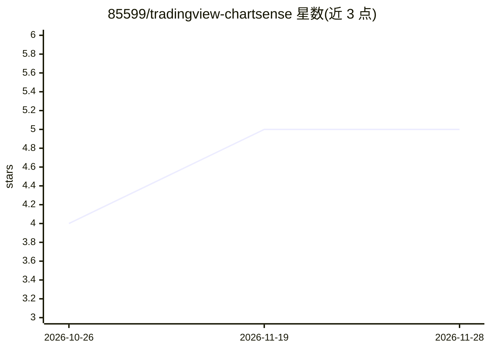

# 85599/tradingview-chartsense

⭐ 5 · TypeScript · MIT · 推送 2026-10-23 · [GitHub](https://github.com/85599/tradingview-chartsense) · 个人维护

**从 TradingView 截图生成技术面解读的可审计本地工具**

本地优先的 Next.js 应用：粘贴 TradingView 截图后输出简明英文技术面解读、水平位、TradingView 风格仪表与置信分。每个数值标注来源（calculated/read/estimated/no basis）；粘贴 OHLCV 后 SMA、EMA、RSI、MACD、Stochastic、ADX、ATR 由 TypeScript 本地计算并覆盖模型猜测值；置信分由十项封顶因子在服务端重算，钳制在 5–85。用户自备 API key（存于 ~/.chartsense），无账号无遥测；亦有无 key 的 Demo 模式仅跑指标数学。仅供教育用途，不构成投资建议。

## 筛选速览

| 维度 | 判定 | 备注 |
|---|---|---|
| AI 角色 | `ai-native` | 本体是模型或模型工具 |
| 许可风险 | `permissive` | MIT |
| 部署形态 | `library` | 以包/库形式分发 |
| 模型依赖 | locked-api |  |
| 硬件要求 | — | 无带数字的原话,不猜 |
| 安装摩擦 | `low` | 无编译、无系统依赖或容器化 |
| 成熟度 | — | 结构信号不足 |

## 能力要点

- 每个输出数值带来源标注（calculated/read/estimated/no basis）
- OHLCV 粘贴后指标由 TypeScript 本地计算，覆盖模型猜测
- 置信分为代码计算，服务端去重重算并钳制 5–85
- API key 存于项目外 ~/.chartsense，含访问令牌与限流

## 适用场景

- 读取 TradingView 截图获得带水平位的技术面摘要
- 粘贴 OHLCV 数据获得不依赖模型的指标计算结果
- 在对话面板中就同一张图继续追问

## 场景标签

`金融量化` `多模态` · 领域:学习与行业

## 证据(README 行号)

> L3: **Drop a TradingView screenshot → get a short plain-English technical read: levels, a TradingView-style gauge, and a
> L14: - **Paste OHLCV candles and the maths stops being AI** — SMA, EMA, RSI, MACD, Stochastic, ADX and ATR computed in T

## 星数曲线

2026-10-26 4 → 2026-11-28 5（+1）

---
*卡片 v1 · prompt 1.4 · 生成 2026-11-21 · 置信度 high · 依据 README sha `7089ee75e1a7` · [字段定义](../../DATASET.md)*
