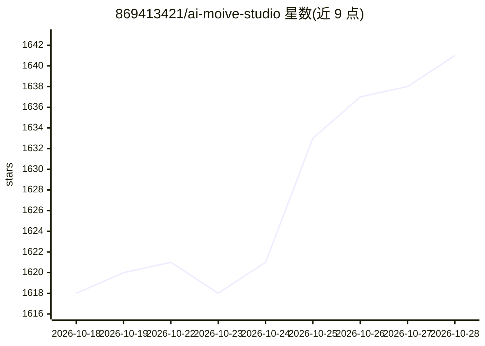

# 869413421/ai-moive-studio

⭐ 1,641 · Python · Apache-2.0 · 推送 2026-09-16 · [GitHub](https://github.com/869413421/ai-moive-studio) · [官网](https://aicon-studio.com) · 个人维护 · 中文 README

**自然语言驱动的无限画布 AI 视频创作工作台**

面向创作者的开源 AI 视频创作系统：以无限画布连接文本、图片、视频节点，自然语言助手负责创建节点与连线，生成任务由用户手动触发。能力覆盖剧本拆解到分镜、角色参考图与关键帧生成、图文配音解说视频合成、素材管理及 Bilibili 分发对接。支持自定义兼容模型服务（OpenAI 协议），通过 Docker Compose 自部署，模型调用费用由所选服务商收取。

## 筛选速览

| 维度 | 判定 | 备注 |
|---|---|---|
| AI 角色 | `ai-native` | 本体是模型或模型工具 |
| 许可风险 | `permissive` | Apache-2.0 |
| 部署形态 | `self-host` | docker 或自建部署 |
| 模型依赖 | — | README 未给出锁定关系 |
| 硬件要求 | — | 无带数字的原话,不猜 |
| 安装摩擦 | `low` | 无编译、无系统依赖或容器化 |
| 成熟度 | — | 结构信号不足 |

## 能力要点

- 无限画布上连接文本/图片/视频节点，自然语言助手搭建工作流
- 剧本拆解为角色、场景与镜头，生成参考图、关键帧和过渡视频
- 按章节生成配图、语音、字幕并合成解说视频
- 支持 Bilibili 分发对接与生成历史管理

## 适用场景

- 把小说或剧本改编为分镜与视频成片
- 在画布上用自然语言搭建并编辑 AI 视频生成工作流
- 生成带配图配音字幕的解说视频并发布到 Bilibili

## 场景标签

`视频生成` `语音合成` · 领域:内容生成

## 证据(README 行号)

> L6: 从小说、剧本到角色、分镜与视频，在无限画布中组织创作。AICON 支持自然语言助手搭建工作流，连接文本、图片和视频节点，也支持 Docker 自部署。
> L27: - **剧本到分镜**：拆解角色、场景与镜头，生成角色参考图、关键帧和过渡视频。
> L28: - **无限画布**：连接文本、图片和视频节点，通过自然语言助手搭建可编辑的工作流。

## 星数曲线

2026-10-18 1,618 → 2026-10-28 1,641（+23）

---
*卡片 v1 · prompt 1.4 · 生成 2026-10-21 · 置信度 high · 依据 README sha `025a772838c1` · [字段定义](../../DATASET.md)*
