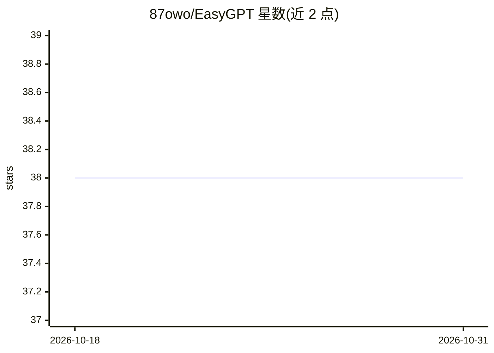

# 87owo/EasyGPT

⭐ 38 · Python · NOASSERTION · 推送 2025-12-24 · [GitHub](https://github.com/87owo/EasyGPT) · [官网](https://github.com/87owo/EasyGPT) · 个人维护

**在个人电脑上训练和推理 GPT 对话模型的轻量框架**

基于 PyTorch 的 GPT 训练与推理项目，面向个人电脑用户，无需大规模 GPU 集群。提供训练数据集格式规范（<|user|>/<|assistant|> 对话模板）、多种参数规模的模型配置表（77M–421M，最低约 8GB 显存），并展示训练 12 epochs 后的对话记录。依赖 bitsandbytes、safetensors、torch、tqdm 等库，按系统与 CUDA 版本选择安装命令；示例数据集从 GitHub Releases 下载。许可证需阅读项目 LICENSE 并通过 issues 申请。

## 筛选速览

| 维度 | 判定 | 备注 |
|---|---|---|
| AI 角色 | `ai-ecosystem` | LLM/agent 周边工具 |
| 许可风险 | `none` | NOASSERTION |
| 部署形态 | `library` | 以包/库形式分发 |
| 模型依赖 | — | README 未给出锁定关系 |
| 硬件要求 | `gpu-8g` | |
| 安装摩擦 | `medium` | 含编译或系统依赖之一 |
| 成熟度 | — | 结构信号不足 |

## 能力要点

- 个人电脑即可完成 GPT 训练与推理，无需集群
- 77M/182M/421M 三档参数规模的模型配置表
- 以 <|user|>/<|assistant|> 模板定义的对话数据集格式

## 适用场景

- 在自己的电脑上从零训练一个小型对话模型
- 按显存大小选择参数规模跑通 GPT 训练流程
- 用 Releases 提供的示例数据集学习对话数据格式

## 场景标签

`模型训练` · 领域:训练与推理

## 证据(README 行号)

> L3: Easily train and inference on your personal computer, no need for large scale clusters!
> L40: <|user|>Hello!<|assistant|>Hello! I am EasyGPT, an AI assistant. How can I help you?<|end|>

## 星数曲线

2026-10-18 38 → 2026-10-31 38（+0）

---
*卡片 v1 · prompt 1.4 · 生成 2026-10-25 · 置信度 mid · 依据 README sha `d6fc48f528c4` · [字段定义](../../DATASET.md)*
