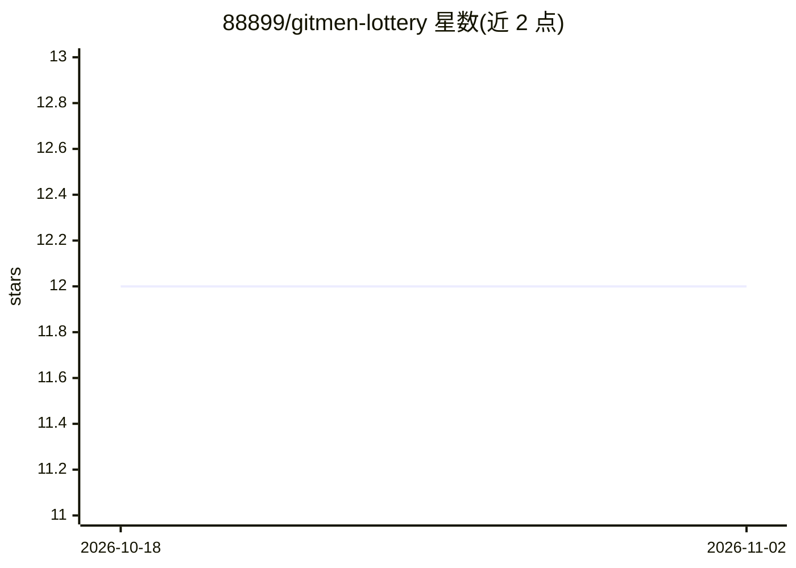

# 88899/gitmen-lottery

⭐ 12 · Python · 推送 2026-01-29 · [GitHub](https://github.com/88899/gitmen-lottery) · 个人维护 · 中文 README

**双色球等四种彩票的数据爬取与统计预测系统**

覆盖双色球、大乐透、七星彩、七乐彩的彩票数据处理系统：从 500.com 增量爬取历史开奖数据存入 MySQL（Worker 版用 D1/KV），提供频率、均衡、冷热号、随机四种策略生成号码组合，支持定时任务自动爬取并预测，结果通过 Telegram 机器人或频道推送。提供 Python 本地版（含 FastAPI Web 查询服务）与 Cloudflare Workers 云端版双实现，README 声明仅供学习、不构成投资建议。

## 筛选速览

| 维度 | 判定 | 备注 |
|---|---|---|
| AI 角色 | `ai-native` | 本体是模型或模型工具 |
| 许可风险 | `none` | — |
| 部署形态 | `library` | 以包/库形式分发 |
| 模型依赖 | — | README 未给出锁定关系 |
| 硬件要求 | — | 无带数字的原话,不猜 |
| 安装摩擦 | `low` | 无编译、无系统依赖或容器化 |
| 成熟度 | — | 结构信号不足 |

## 能力要点

- 支持双色球/大乐透/七星彩/七乐彩四种彩票
- 四种统计策略（频率/均衡/冷热号/随机）生成组合
- Python 与 Cloudflare Workers 双版本，统一爬取与增量逻辑
- Telegram 机器人与频道推送预测结果

## 适用场景

- 定时爬取彩票开奖数据并自动生成预测推送
- 通过 Web 服务查询历史开奖与统计
- 学习爬虫、定时任务与数据统计分析的实现

## 场景标签

`网页抓取` `数据分析` · 领域:效率与自动化

## 证据(README 行号)

> L3: 基于历史数据分析的彩票预测系统，支持双色球、大乐透和七星彩。
> L12: - 📊 **多策略预测**：频率、随机、均衡、冷热号

## 星数曲线

2026-10-18 12 → 2026-11-02 12（+0）

---
*卡片 v1 · prompt 1.4 · 生成 2026-11-01 · 置信度 mid · 依据 README sha `a6fab005fbb9` · [字段定义](../../DATASET.md)*
