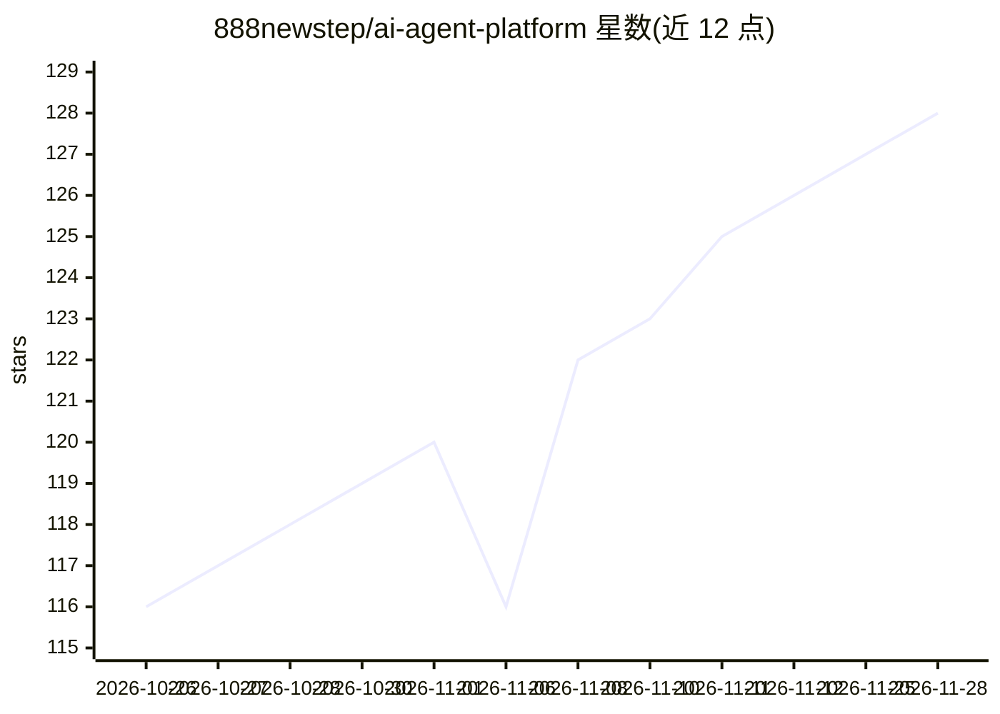

# 888newstep/ai-agent-platform

⭐ 128 · Java · NOASSERTION · 推送 2026-11-24 · [GitHub](https://github.com/888newstep/ai-agent-platform) · 个人维护 · 中文 README

**给开发者的 Java 企业 AI Agent 服务端：RAG+ReAct+评测**

基于 Spring Boot 3.5 + LangChain4j 的 Java 17 服务端，面向企业知识问答与智能客服场景，覆盖文档入库、向量+关键词混合召回与 RRF 融合、证据门禁、ReAct 推理、语义缓存、多模型路由降级、SSE 流式响应，并内置 RAG 评测服务与 Prometheus/Grafana 可观测。通过 Docker Compose 一键启动 MySQL/Redis/Milvus 及应用；README 标明 FAQ 指标为域内 multi-gold 口径，泛化区间另行给出。

## 筛选速览

| 维度 | 判定 | 备注 |
|---|---|---|
| AI 角色 | `ai-ecosystem` | LLM/agent 周边工具 |
| 许可风险 | `none` | NOASSERTION |
| 部署形态 | `self-host` | docker 或自建部署 |
| 模型依赖 | local-ok | 支持本地模型 |
| 硬件要求 | — | 无带数字的原话,不猜 |
| 安装摩擦 | `low` | 无编译、无系统依赖或容器化 |
| 成熟度 | — | 结构信号不足 |

## 能力要点

- 多路召回：Milvus 向量 + BM25 关键词 + RRF(k=60) 融合
- 语义缓存（embedding 余弦 0.92 阈值）与多模型路由降级
- 内置 RAG 评测服务，指标快照提交仓库可复核
- 证据门禁：证据不足转人工，支持 JWT 鉴权与限流

## 适用场景

- 搭建企业知识库或内部问答服务
- 构建带证据校验的智能客服系统
- 系统学习 Java + AI Agent + RAG 的完整工程链路
- 对检索效果做可复现的量化评测与回归

## 场景标签

`RAG` `模型评测` `模型网关` `文档问答` · 领域:Agent 开发

## 证据(README 行号)

> L3: 基于 **Spring Boot 3.5 + LangChain4j 0.34** 构建的 Java 17 AI Agent 服务端。围绕企业知识问答与智能客服，提供 ReAct、Hybrid RAG、Function Callin
> L38: - 想系统学习 **Java + AI Agent + RAG** 完整工程链路的开发者
> L39: - 需要搭建企业知识库、智能客服或内部问答服务的团队

## 星数曲线

2026-10-26 116 → 2026-11-28 128（+12）

---
*卡片 v1 · prompt 1.4 · 生成 2026-11-28 · 置信度 high · 依据 README sha `58664d31a15f` · [字段定义](../../DATASET.md)*
