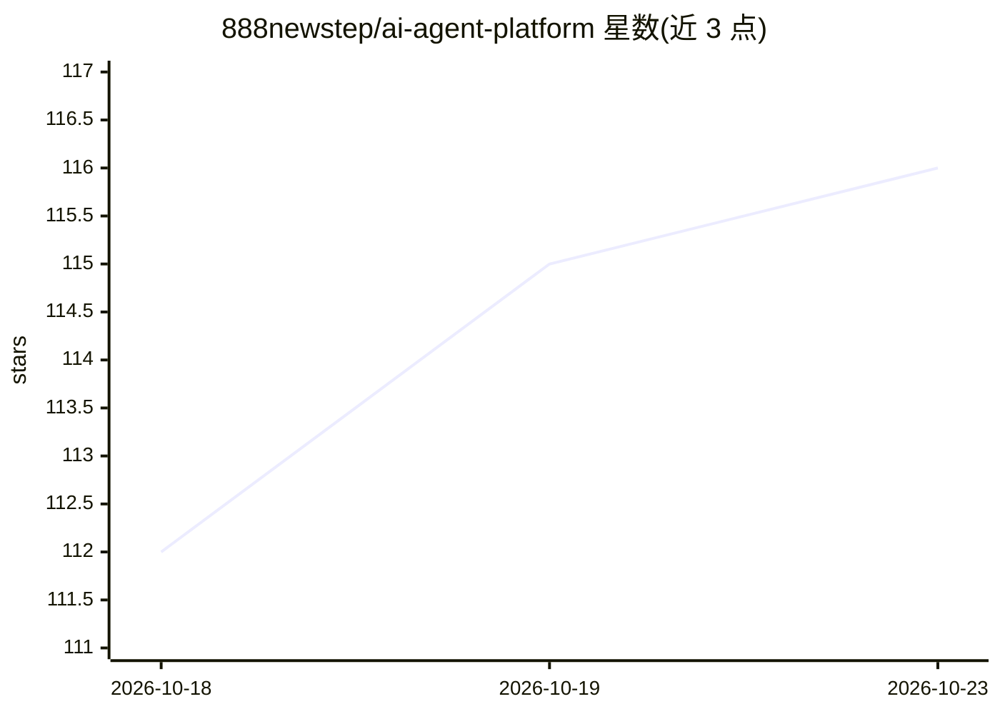

# 888newstep/ai-agent-platform

⭐ 116 · Java · NOASSERTION · 推送 2026-10-11 · [GitHub](https://github.com/888newstep/ai-agent-platform) · 个人维护 · 中文 README

**Java 企业知识问答与智能客服 AI Agent 服务端**

基于 Spring Boot 3.5 + LangChain4j 0.34 的 Java 17 服务端，面向企业知识问答与智能客服场景：提供 ReAct 推理循环（带步数/超时/死循环防护）、Milvus 向量 + BM25 + RRF 融合的多路召回 RAG、embedding 语义缓存、多模型路由（DeepSeek/通义千问/豆包/Ollama 降级）、证据门禁与转人工、JWT 鉴权与 Prometheus/Grafana 观测。内置可复现 RAG 评测体系与 372 个测试。通过 Docker Compose 一条命令启动 MySQL+Redis+Milvus+应用，需 JDK 17+。演示数据为 10 万条电商客服 QA 对。

## 筛选速览

| 维度 | 判定 | 备注 |
|---|---|---|
| AI 角色 | `ai-ecosystem` | LLM/agent 周边工具 |
| 许可风险 | `none` | NOASSERTION |
| 部署形态 | `self-host` | docker 或自建部署 |
| 模型依赖 | local-ok | 支持本地模型 |
| 硬件要求 | — | 无带数字的原话,不猜 |
| 安装摩擦 | `low` | 无编译、无系统依赖或容器化 |
| 成熟度 | — | 结构信号不足 |

## 能力要点

- ReAct 循环带死循环/超时/步数三重防护
- Milvus 向量 + BM25 + RRF(k=60) 多路召回与证据门禁
- 语义缓存（0.92 阈值、24h TTL）+ 多模型路由与本地模型降级
- 内置可复现 RAG 评测（multi-gold R@1 98.3%）与 372 个测试

## 适用场景

- 搭建企业知识库问答或智能客服服务
- 系统学习 Java 技术栈的 AI Agent + RAG 工程链路
- 上线前用独立数据集量化检索与回答质量

## 场景标签

`文档问答` `RAG` `聊天机器人` · 领域:对话与助手

## 证据(README 行号)

> L3: 基于 **Spring Boot 3.5 + LangChain4j 0.34** 构建的 Java 17 AI Agent 服务端。围绕企业知识问答与智能客服，提供 ReAct、Hybrid RAG、Function Callin
> L46: |**多模型路由**|DeepSeek / 通义千问 / 豆包 / Qwen3-Flash / Ollama 策略切换|主模型故障自动降级本地模型|

## 星数曲线

2026-10-18 112 → 2026-10-23 116（+4）

---
*卡片 v1 · prompt 1.4 · 生成 2026-10-23 · 置信度 high · 依据 README sha `4157bce3a463` · [字段定义](../../DATASET.md)*
