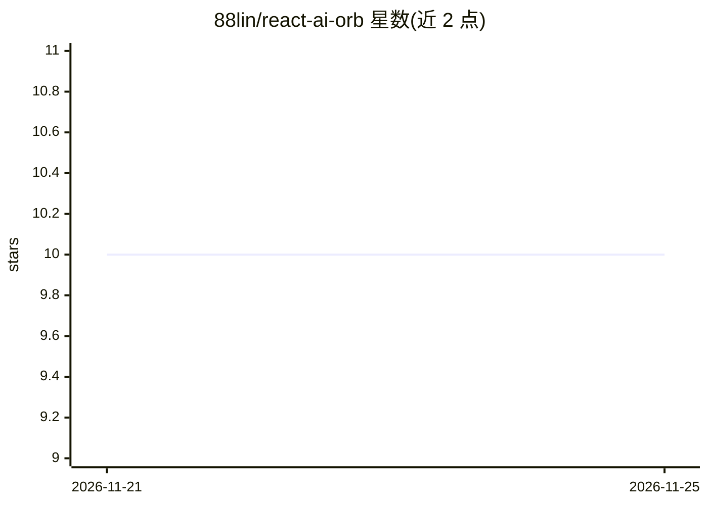

# 88lin/react-ai-orb

⭐ 10 · TypeScript · MIT · 推送 2026-11-23 · [GitHub](https://github.com/88lin/react-ai-orb) · [官网](https://88lin.github.io/react-ai-orb) · 个人维护 · 中文 README

**给 React AI 界面提供发光动画球体组件**

一个 React 发光球体 UI 组件：纯 CSS 动画实现，不依赖 canvas/WebGL/动画库，零运行时依赖，产物约 4.8 KB（gzip）。内置 8 套调色板与 8 个预设，支持自定义配色、运行时平滑调速、任意缩放，并跟随系统「减弱动态效果」设置停止动画。样式内联进 dist/，需 React 19 peer 依赖，Next.js App Router 下作为客户端组件使用；dist/ 随仓库提交，安装后无需本地构建。

## 筛选速览

| 维度 | 判定 | 备注 |
|---|---|---|
| AI 角色 | `ai-enhanced` | 去掉 AI 部分产品仍成立 |
| 许可风险 | `permissive` | MIT |
| 部署形态 | `library` | 以包/库形式分发 |
| 模型依赖 | — | README 未给出锁定关系 |
| 硬件要求 | — | 无带数字的原话,不猜 |
| 安装摩擦 | `low` | 无编译、无系统依赖或容器化 |
| 成熟度 | — | 结构信号不足 |

## 能力要点

- 纯 CSS 动画，零运行时依赖，产物约 4.8 KB（gzip）
- 8 套调色板与 8 个内置预设，配色可完全自定义
- 通过 Web Animations playbackRate 实时调速，不跳帧重启
- 尊重 prefers-reduced-motion，支持多实例独立渲染

## 适用场景

- 给 AI 助手界面加一个发光球体作为状态指示
- 聊天机器人应用中做加载/待机的动画元素
- 页面内联状态点或全屏主视觉的动画装饰

## 场景标签

 · 领域:前端 UI 组件

## 证据(README 行号)

> L11: **一个美观、可定制的 React 动画球体组件。**
> L13: 适合 AI 界面、智能助手、聊天机器人，或者任何需要一颗发光球体的地方 ✨
> L22: - ⚡ **纯 CSS 动画** — 不依赖 canvas、WebGL 或任何动画库，性能轻盈

## 星数曲线

2026-11-21 10 → 2026-11-25 10（+0）

---
*卡片 v1 · prompt 1.4 · 生成 2026-11-21 · 置信度 high · 依据 README sha `627f6cf6cacd` · [字段定义](../../DATASET.md)*
