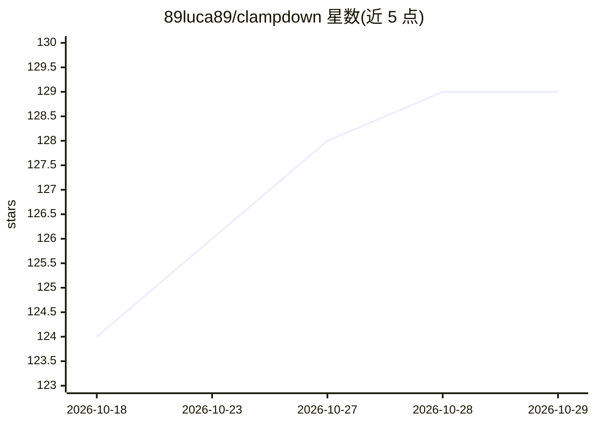

# 89luca89/clampdown

⭐ 129 · Go · NOASSERTION · 推送 2026-10-15 · [GitHub](https://github.com/89luca89/clampdown) · 个人维护

**在加固容器沙箱中运行 AI 编程 agent 的安全工具**

将 AI 编程 agent 限制在多容器沙箱中运行：特权 sidecar 运行 podman 并执行 iptables 防火墙规则，auth proxy 独占真实 API key 并向 agent 注入 dummy key，agent 与其派生的工具容器分别受 Landlock、seccomp（约150个系统调用阻断）与 OCI hook（17 项安全校验、无豁免）约束；网络默认拒绝并按域名 allowlist 放行，工具容器出口开放但阻断私有网段。要求 Linux 内核 >=6.2（Landlock V3 硬性要求），推荐 >=6.12；支持原生 Linux、podman machine 与 colima VM，macOS Docker Desktop 不受支持。

## 筛选速览

| 维度 | 判定 | 备注 |
|---|---|---|
| AI 角色 | `ai-ecosystem` | LLM/agent 周边工具 |
| 许可风险 | `none` | NOASSERTION |
| 部署形态 | `library` | 以包/库形式分发 |
| 模型依赖 | locked-api |  |
| 硬件要求 | — | 无带数字的原话,不猜 |
| 安装摩擦 | `medium` | 含编译或系统依赖之一 |
| 成熟度 | — | 结构信号不足 |

## 能力要点

- 四类容器分层特权设计：sidecar/auth proxy/agent/嵌套工具容器
- auth proxy 独占真实 API key，agent 仅持 dummy key，直连上游返回 401
- OCI hook 对 agent 创建的每个容器执行 17 项安全校验，无豁免路径
- Landlock V3 文件系统隔离（内核 >=6.2 硬性要求）+ seccomp-notif 拦截 20 个系统调用

## 适用场景

- 在本地安全地运行会执行任意代码的 AI 编程 agent
- 防止 prompt injection 或 agent 越权访问 SSH key、.env 等敏感文件
- 企业内隔离 agent 的 API key 与网络出口并留存请求审计日志

## 场景标签

`网络安全` · 领域:学习与行业

## 证据(README 行号)

> L5: Run AI coding agents in hardened container sandboxes.
> L7: AI coding agents run arbitrary code on your machine. clampdown confines them to a
> L8: hardened container sandbox: filesystem access is restricted to your project, network

## 星数曲线

2026-10-18 124 → 2026-10-29 129（+5）

---
*卡片 v1 · prompt 1.4 · 生成 2026-10-23 · 置信度 mid · 依据 README sha `12893146c46b` · [字段定义](../../DATASET.md)*
