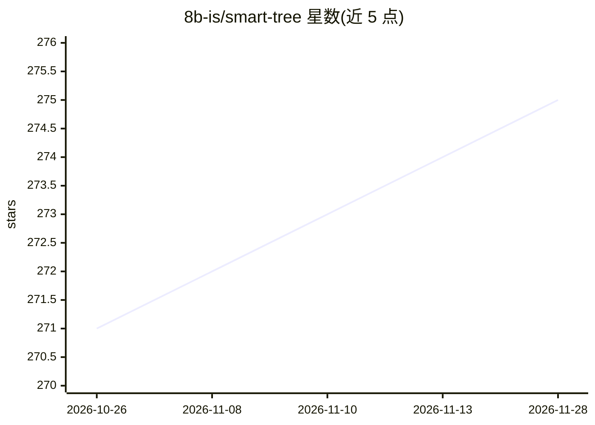

# 8b-is/smart-tree

⭐ 275 · Rust · MIT · 推送 2026-11-24 · [GitHub](https://github.com/8b-is/smart-tree) · [官网](https://s.8b.is/q/3PNnlY6jT) · 个人维护

**AI 原生目录分析与压缩工具，为 AI Agent 提供 50+ MCP 工具**

Rust 编写的目录分析工具，自称较传统 tree 快 10–24 倍，输出 MEM8 格式压缩文件（含 WAVE/MQNT/ZLIB 分节的二进制容器），提供 50+ Agent 无关的 MCP 工具、`--agent-hook` 钩子、HTTP API 与守护进程/Web 仪表盘（端口 28428/28429）。内置会话级记忆库（~/.st/memories.m8）、实时服务调试模式、Mechanic's Helper 工具会话参数管理。安装通过一行 shell 脚本；README 内容含大量混合叙述，部分功能声明难以独立核实。

## 筛选速览

| 维度 | 判定 | 备注 |
|---|---|---|
| AI 角色 | `ai-ecosystem` | LLM/agent 周边工具 |
| 许可风险 | `permissive` | MIT |
| 部署形态 | `desktop` | 安装包/桌面程序 |
| 模型依赖 | — | README 未给出锁定关系 |
| 硬件要求 | — | 无带数字的原话,不猜 |
| 安装摩擦 | `medium` | 含编译或系统依赖之一 |
| 成熟度 | — | 结构信号不足 |

## 能力要点

- 50+ Agent 无关 MCP 工具，支持 stdio 与 HTTP 传输
- MEM8 v1 二进制容器：WAVE/MQNT/ZLIB/T8RZ 分节，CRC32 校验，O(1) 头部扫描
- Agent 钩子（--agent-hook）与实时服务调试模式（JSONL 日志）
- m8 pack/inspect/validate CLI 对 .m8 文件打包与校验

## 适用场景

- 让 MCP 兼容的 AI Agent 读取压缩后的目录上下文
- 对代码库目录树做分析与语义摘要持久化
- 调试 Agent 与本工具之间的 MCP/钩子流量

## 场景标签

 · 领域:开发者工具/AI Agent 基础设施

## 证据(README 行号)

> L1: # 🌳 Smart Tree - The Smart Treehouse: Cyber-Botanical Dashboard & Agent-Agnostic Hooks! 🌐
> L14: > **Smart Tree v24.0.0 (`/flow` Live Visual Studio Diff Engine & Brett Favre Play-by-Play + Realtime Service Debug 
> L65:  - Renamed `Claude`-specific UI buttons, hook descriptions, and CLI aliases (`--agent-hook`) to be **AI Agent** gen

## 星数曲线

2026-10-26 271 → 2026-11-28 275（+4）

---
*卡片 v1 · prompt 1.4 · 生成 2026-11-25 · 置信度 low · 依据 README sha `7368af9f8538` · [字段定义](../../DATASET.md)*
