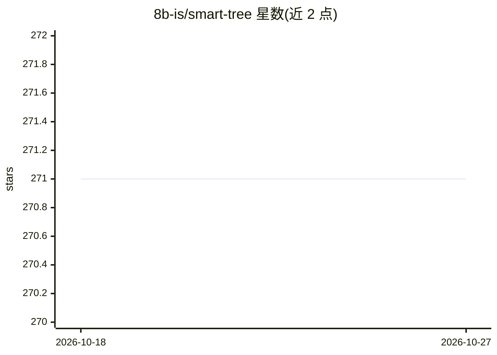

# 8b-is/smart-tree

⭐ 271 · Rust · MIT · 推送 2026-10-25 · [GitHub](https://github.com/8b-is/smart-tree) · [官网](https://s.8b.is/q/3PNnlY6jT) · 个人维护

**面向 AI 助手的目录可视化与 MCP 工具集（Rust 实现）**

用 Rust 编写的命令行目录树工具，自称比传统 tree 快 10-24 倍，提供 30+ MCP 工具供 Claude Desktop 等 AI 客户端调用（quick_tree、记忆锚定、会话保存恢复等）。附加功能包括：MCP 集成安全扫描（检测 13 种供应链攻击模式）、Spicy TUI 交互式文件浏览、浏览器端 Web Dashboard 与 PTY 终端、证书扫描、Google Drive/Gmail 同步与语音功能（v10）。安装方式为一行 curl/PowerShell 脚本下载二进制，或从源码构建。

## 筛选速览

| 维度 | 判定 | 备注 |
|---|---|---|
| AI 角色 | `ai-ecosystem` | LLM/agent 周边工具 |
| 许可风险 | `permissive` | MIT |
| 部署形态 | `desktop` | 安装包/桌面程序 |
| 模型依赖 | — | README 未给出锁定关系 |
| 硬件要求 | — | 无带数字的原话,不猜 |
| 安装摩擦 | `medium` | 含编译或系统依赖之一 |
| 成熟度 | — | 结构信号不足 |

## 能力要点

- 30+ MCP 工具，含 MCP 自动安装到 Claude Desktop
- 供应链攻击检测：13 种攻击模式、7 个已知恶意 npm 包识别
- AI 会话记忆：agent-save/restore 与 memory-anchor 锚定
- Spicy TUI 交互浏览与 Web Dashboard（PTY 终端、文件浏览器）

## 适用场景

- 让 AI 编码助手通过 MCP 快速理解代码库结构并保存跨会话记忆
- 扫描并清理恶意 MCP 服务器与 Claude Code hooks
- 在终端或浏览器中交互式浏览目录与文件内容

## 场景标签

`网络安全` · 领域:学习与行业

## 证据(README 行号)

> L11: > **Smart Tree** is a blazingly fast, AI-friendly directory visualization tool that's 10-24x faster than traditiona
> L49: 6. 🔧 **MCP Server** - Model Context Protocol (stdio)
> L157: **One command to rule them all!** Automatically install Smart Tree as an MCP server in Claude Desktop:

## 星数曲线

2026-10-18 271 → 2026-10-27 271（+0）

---
*卡片 v1 · prompt 1.4 · 生成 2026-10-22 · 置信度 mid · 依据 README sha `d5466fb584d0` · [字段定义](../../DATASET.md)*
