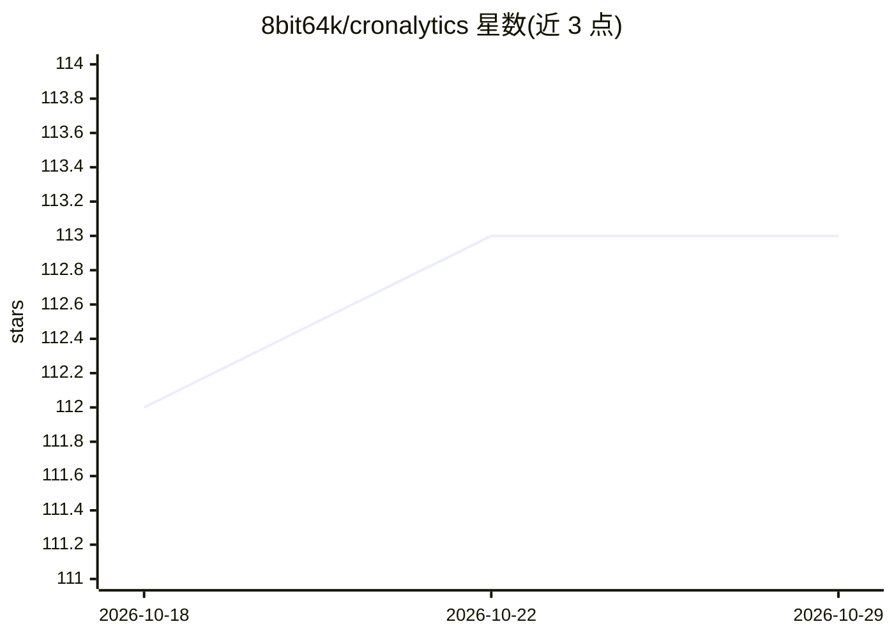

# 8bit64k/cronalytics

⭐ 113 · Python · MIT · 推送 2026-06-24 · [GitHub](https://github.com/8bit64k/cronalytics) · 个人维护 · 中文 README

**Hermes Agent 定时任务的成本与运行可观测性插件**

面向 Hermes Agent（Nous Research 的自主 agent 框架）的插件：通过 on_session_end 钩子捕获每次 cron 起源的运行，从 state.db 读取会话数据并将成本、token 数、模型、时长、成败状态等写入插件自有的 SQLite 事实库 facts.db。数据通过三个界面暴露：hermes dashboard 中的 /cronalytics 标签页、含八个命令并支持 --json 输出的 CLI 工具，以及一个按 7 步诊断流程做置信度分级异常检测的 agent 技能。UI 提供英/西/简中/繁中四种语言。限制：成本为估算值、success 仅反映 wrapper 层成功、默认仅监控默认 profile、崩溃或卡住的会话不可见。安装细节在 docs/INSTALL.md 中给出。

## 筛选速览

| 维度 | 判定 | 备注 |
|---|---|---|
| AI 角色 | `ai-ecosystem` | LLM/agent 周边工具 |
| 许可风险 | `permissive` | MIT |
| 部署形态 | `None` |  |
| 模型依赖 | — | README 未给出锁定关系 |
| 硬件要求 | — | 无带数字的原话,不猜 |
| 安装摩擦 | `low` | 无编译、无系统依赖或容器化 |
| 成熟度 | — | 结构信号不足 |

## 能力要点

- on_session_end 钩子捕获 cron 运行并存入 append-only 的 facts.db
- dashboard / CLI（8 命令、--json）/ agent 诊断技能三种界面
- 7 步结构化诊断流程与 HIGH/MEDIUM/LOW 置信度分级异常检测
- UI 支持 English/Spanish/简体中文/繁体中文四种语言

## 适用场景

- 查看定时 agent 任务的成本、token 消耗与失败模式
- 让 agent 分析近两周 cron 任务并标记异常
- 通过脚本以 --json 输出方式消费 cron 运行数据

## 场景标签

`LLM 可观测性` · 领域:评测与运维

## 证据(README 行号)

> L37: Cronalytics is a Hermes Agent plugin that attributes session-level usage and estimated cost to every cron-originate
> L216: Cronalytics hooks into Hermes's `on_session_end`, enqueues session IDs, queries `state.db`, and stores derived ana

## 星数曲线

2026-10-18 112 → 2026-10-29 113（+1）

---
*卡片 v1 · prompt 1.4 · 生成 2026-10-23 · 置信度 high · 依据 README sha `c627668ef94d` · [字段定义](../../DATASET.md)*
