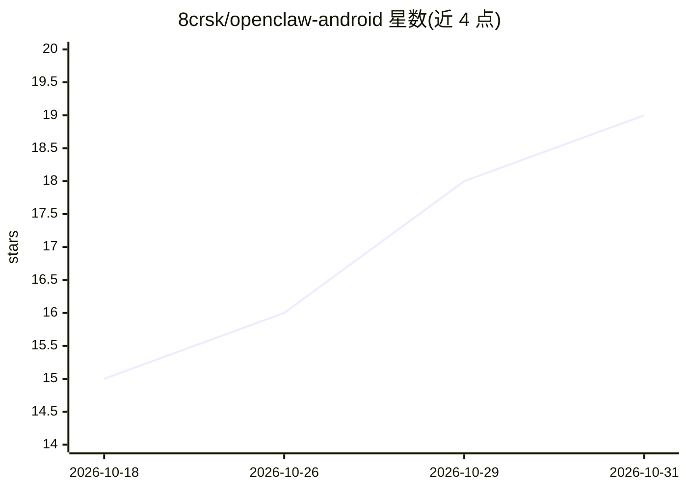

# 8crsk/openclaw-android

⭐ 19 · Kotlin · MIT · 推送 2026-10-14 · [GitHub](https://github.com/8crsk/openclaw-android) · [官网](https://4ais.in) · 个人维护

**在 Android 手机本地运行的 AI agent，通过读屏与模拟点击代办手机操作**

面向 Android 用户的端上 AI agent 应用（4AIs）：通过 AccessibilityService 读取屏幕无障碍树，以编号 legend 方式向所选 LLM 描述界面，由模型发出 tap/type 等命令，agent 实际执行点击、滑动与输入以完成多步任务。内置 OpenClaw 网关（Node.js 以 libnode.so 形式运行于应用内），自带密钥接入 NVIDIA/OpenAI/Anthropic/Gemini，密钥存于 Android 加密 Keystore；高风险操作需用户批准并留端上审计日志。要求 arm64、Android 8.0+ 设备，APK 自 Releases 安装，首次引导约 3 分钟、约 200MB。自述处于早期阶段。

## 筛选速览

| 维度 | 判定 | 备注 |
|---|---|---|
| AI 角色 | `ai-native` | 本体是模型或模型工具 |
| 许可风险 | `permissive` | MIT |
| 部署形态 | `None` |  |
| 模型依赖 | — | README 未给出锁定关系 |
| 硬件要求 | — | 无带数字的原话,不猜 |
| 安装摩擦 | `low` | 无编译、无系统依赖或容器化 |
| 成熟度 | `idea` | |

## 能力要点

- AccessibilityService 读取屏幕并执行真实点击/输入的 UI 自动化，无需 root 与 ADB
- OpenClaw 网关（Node.js）以 libnode.so 形式在应用内运行，无自有后端服务器
- 自带密钥接入 NVIDIA/OpenAI/Anthropic/Gemini，密钥存于 Android 加密 Keystore
- 分级风险审批对话框与端上审计日志；可选 Composio 接入 300+ 应用作为 MCP 工具

## 适用场景

- 让 AI 代为操作手机应用，如总结未读聊天、查找并分享信息
- 通过 Heartbeat 定时触发例行动作（查日历、发计划）
- 无障碍需求的免手持手机控制
- 自动化没有 API 的应用内重复流程

## 场景标签

`GUI 自动化` `AI 助手` · 领域:效率与自动化

## 证据(README 行号)

> L21: screen through an AccessibilityService, plans with the LLM of your choice, and
> L29: - 📱 **The whole agent runs on-device** — the OpenClaw
> L30:  gateway (Node.js) runs inside the app as `libnode.so`. Your phone *is* the

## 星数曲线

2026-10-18 15 → 2026-10-31 19（+4）

---
*卡片 v1 · prompt 1.4 · 生成 2026-10-29 · 置信度 high · 依据 README sha `d4ad11ea8403` · [字段定义](../../DATASET.md)*
