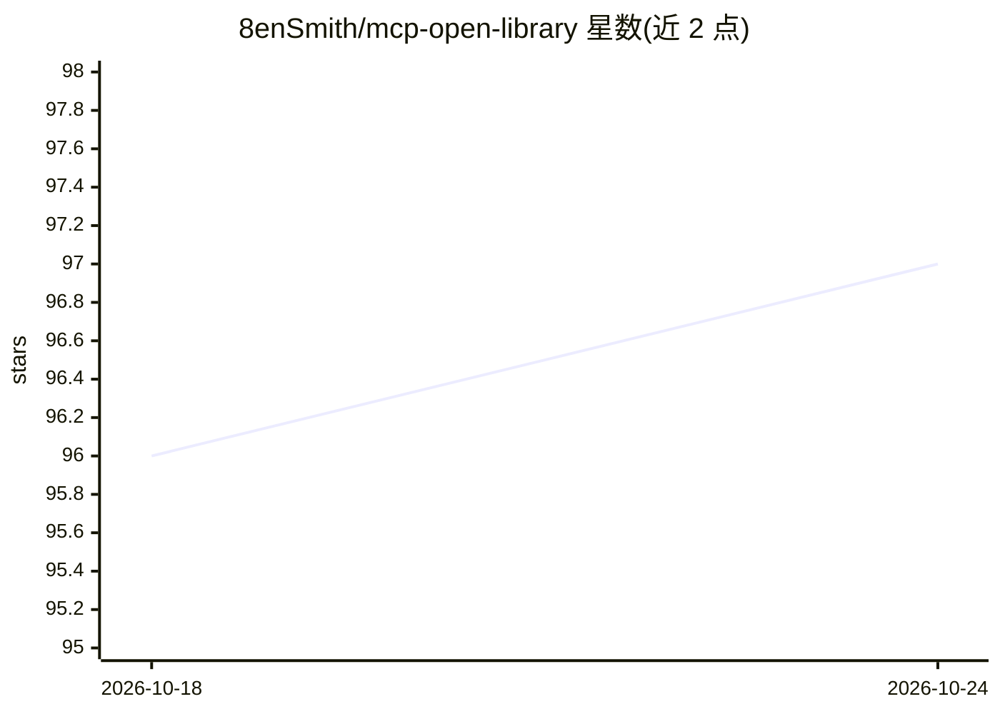

# 8enSmith/mcp-open-library

⭐ 97 · TypeScript · MIT · 推送 2026-10-22 · [GitHub](https://github.com/8enSmith/mcp-open-library) · 个人维护

**为 AI 助手提供 Open Library 图书/作者检索的 MCP 服务器**

实现 Model Context Protocol 的服务器，向 Claude Desktop 等 MCP 兼容客户端暴露 7 个只读工具：按标题/作者/主题/ISBN 等多字段检索图书目录、按姓名检索作者、按 OLID/ISBN/LCCN/OCLC 等标识符获取图书详情、封面与作者照片 URL。返回 JSON 投影而非原始载荷；封面工具会校验图片是否存在；工具标注 readOnlyHint。无需安装构建，可用 npx 直接拉取，也提供 git clone 手动安装与 Docker 测试方式。限制：搜索结果分页 limit≤50、offset≤1000。

## 筛选速览

| 维度 | 判定 | 备注 |
|---|---|---|
| AI 角色 | `ai-ecosystem` | LLM/agent 周边工具 |
| 许可风险 | `permissive` | MIT |
| 部署形态 | `self-host` | docker 或自建部署 |
| 模型依赖 | — | README 未给出锁定关系 |
| 硬件要求 | — | 无带数字的原话,不猜 |
| 安装摩擦 | `low` | 无编译、无系统依赖或容器化 |
| 成熟度 | — | 结构信号不足 |

## 能力要点

- 7 个只读工具覆盖图书/作者检索、详情与封面 URL 获取
- 返回 JSON 投影而非原始 Open Library 载荷
- 工具标注 readOnlyHint/openWorldHint，错误以 isError 工具结果返回
- 支持 npx 免安装运行，并发布到官方 MCP Registry

## 适用场景

- 让 Claude Desktop 等 MCP 客户端检索 Open Library 书目与作者信息
- 在 AI 助手对话中查询图书封面与作者照片 URL
- 通过 MCP Inspector 测试和调试服务器工具

## 场景标签

 · 领域:AI 工具接入/图书数据

## 证据(README 行号)

> L9: A Model Context Protocol (MCP) server for the Open Library API that enables AI assistants to search for book and aut
> L17: This project implements an MCP server that provides tools for AI assistants to interact with the Open Library. It a
> L87: This server implements the Model Context Protocol, which means it can be used by any MCP-compatible AI assistant or

## 星数曲线

2026-10-18 96 → 2026-10-24 97（+1）

---
*卡片 v1 · prompt 1.4 · 生成 2026-10-23 · 置信度 high · 依据 README sha `e03f474004c7` · [字段定义](../../DATASET.md)*
