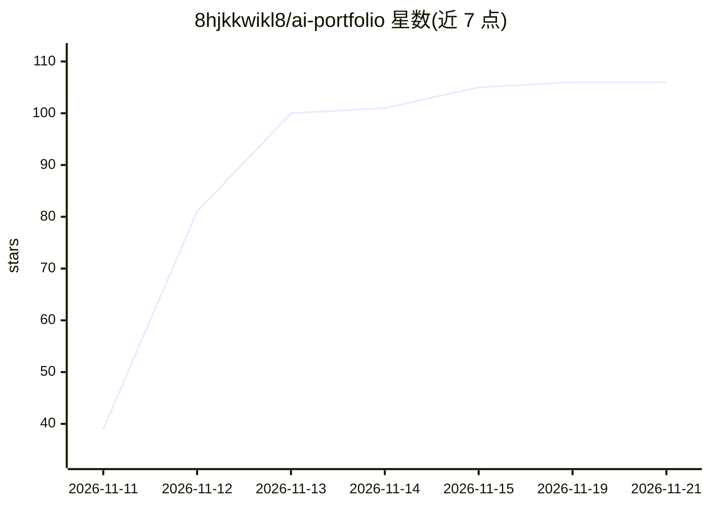

# 8hjkkwikl8/ai-portfolio

⭐ 106 · Python · MIT · 推送 2026-11-19 · [GitHub](https://github.com/8hjkkwikl8/ai-portfolio) · [官网](https://8hjkkwikl8.github.io/ai-portfolio/) · 个人维护 · 中文 README

**AI 应用工程师求职作品集：可追溯 RAG、提示词评测与安全 NL2SQL 三个项目**

面向 AI 应用工程师求职的作品集仓库，含三个可运行项目：InsightRAG（混合检索 BM25+哈希向量 RRF 融合、证据字符区间回放、逐句引用校验、金标评测）、PromptLens（内容哈希固定提示词版本、可复现实验、失败隔离重试、成本估算）与 DataChat BI（自然语言到只读 SQL 的多层守护，含白名单表与受控 JOIN）。默认离线运行、无需 API Key，通过 OpenAI 兼容接口可切换真实模型。要求 Python 3.13，核心演示零第三方依赖，Web 服务需 FastAPI/uvicorn。演示数据规模小（3 篇文档/48 行订单），指标不外推生产场景，单机演示不含账号与分布式。

## 筛选速览

| 维度 | 判定 | 备注 |
|---|---|---|
| AI 角色 | `ai-native` | 本体是模型或模型工具 |
| 许可风险 | `permissive` | MIT |
| 部署形态 | `library` | 以包/库形式分发 |
| 模型依赖 | — | README 未给出锁定关系 |
| 硬件要求 | — | 无带数字的原话,不猜 |
| 安装摩擦 | `low` | 无编译、无系统依赖或容器化 |
| 成熟度 | — | 结构信号不足 |

## 能力要点

- BM25 与哈希 n-gram 向量并行召回，RRF 融合，证据保留字符区间可回放原文
- 在线生成回答须逐句通过引用编号校验，否则回退离线摘要
- NL2SQL 多层安全边界：词法预检、表白名单、受控 JOIN、只读 URI 与 SQLite authorizer
- PromptLens 用内容哈希固定提示词版本，输出可比较指标与单文件 HTML 报告

## 适用场景

- 展示 AI 工程能力作为求职作品集
- 在无 API Key 环境下验证 RAG 评测与 NL2SQL 守护链路
- 参考离线优先、模型输出当不可信输入的工程设计模式

## 场景标签

`RAG` `模型评测` `数据分析` · 领域:效率与自动化

## 证据(README 行号)

> L10: 面向 AI 应用工程师求职的作品集：**1 个检索增强生成旗舰项目 + 2 个轻量工程切面项目**。每个项目都有完整源码、确定性演示数据、自动化测试和可查看产物；默认不需要 API Key，也不把规则模拟包装成“智能”。
> L18: |InsightRAG|旗舰 · RAG|混合检索、可插拔嵌入适配器、证据回放、逐句引用校验、人工忠实度与金标评测|30|评测 JSON|
> L19: |PromptLens|轻量 · LLM 评测|不可变提示词版本、可复现实验、失败隔离与重试、成本估算、重复运行稳定性|39|对比报告|
> L20: |DataChat BI|轻量 · AI + 数据安全|自然语言到只读 SQL 的完整安全边界，含受控多表 JOIN|58|图表报告|

## 星数曲线

2026-11-11 39 → 2026-11-21 106（+67）

---
*卡片 v1 · prompt 1.4 · 生成 2026-11-17 · 置信度 high · 依据 README sha `d3f0e8986635` · [字段定义](../../DATASET.md)*
